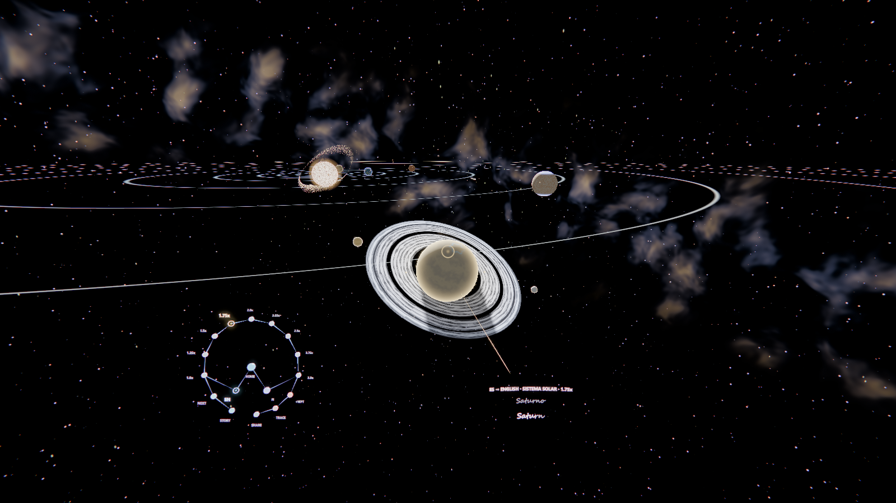
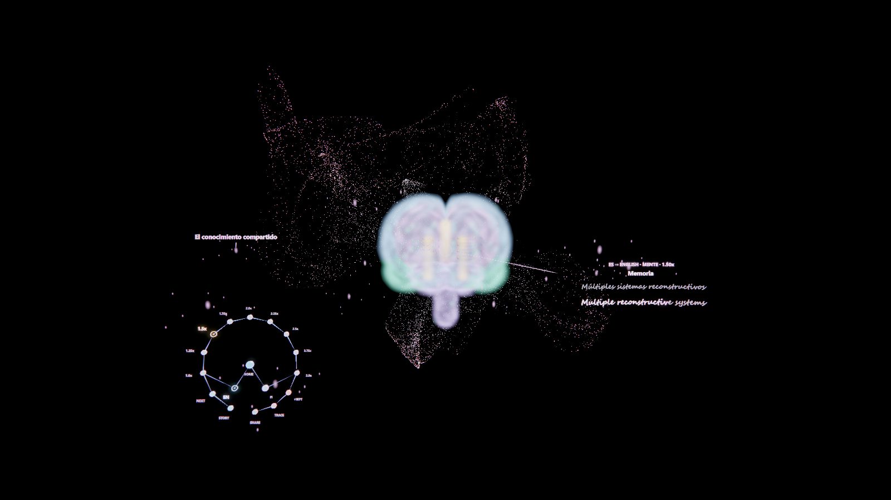
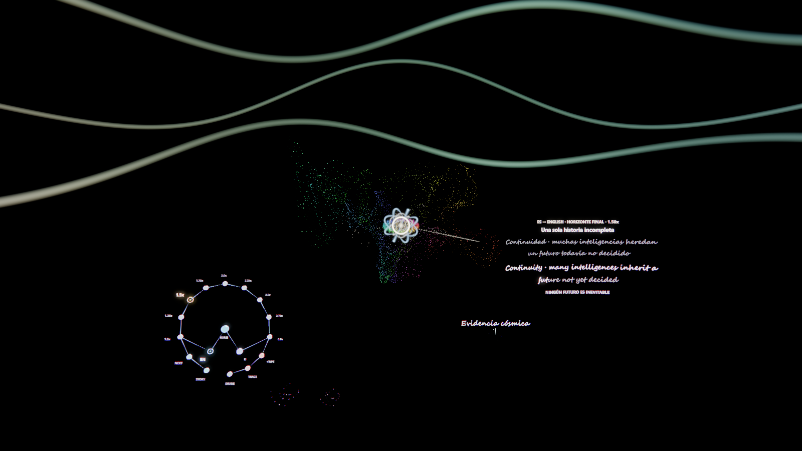
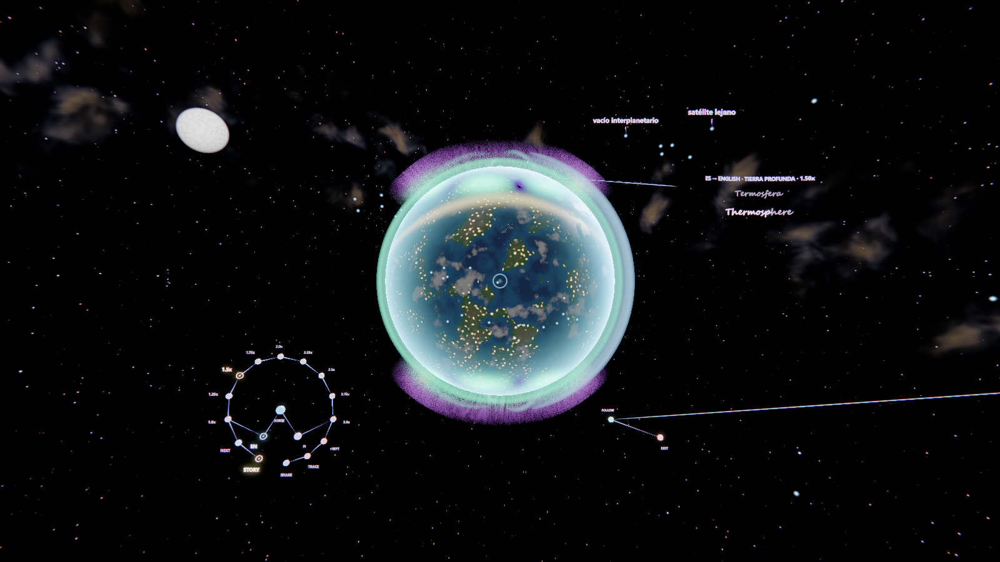

# HyperCosmosVR

**Continuous 3D Multi-Scale VR & Desktop HDR Cosmos (`10⁻³⁶ m` Planck Foam to `10⁺³⁰ m` Hyper-Horizons) — Native Rust, DirectX 12, OpenXR Stereo Multiview, Zero 2D UI, and Bilingual Live-Ink Narration**

[](LICENSE-MIT)
[-orange.svg)](Cargo.toml)
[](docs/platform_spec.md)
[](https://github.com/RONITERVO/HyperCosmosVR/actions/workflows/ci.yml)

**HyperCosmosVR** unifies all **25 documentary experiences** from [RONITERVO/Spanish-Quick-Apps](https://github.com/RONITERVO/Spanish-Quick-Apps) and [RONITERVO/Spanish-Quick-Apps-audio](https://github.com/RONITERVO/Spanish-Quick-Apps-audio) into one boundaryless, pure-`#000000` OLED 3D simulation. There are **no 2D menus, no HUDs, no loading screens, and no teleport cuts**: you fly freely from quantum spin-foam up through Earth's interior, the Solar System, cosmic web filaments, emergence of mind/music/civilization, and philosophical horizon worlds. When you pause in space, the cosmos illuminates the subject and speaks in **Spanish** with word-synchronized 3D calligraphy and **English / Finnish** translations.

---

## Navigation by Role

| If you are evaluating or working on... | Jump directly to... |
| :--- | :--- |
| **Product / Education / Execs (Non-Technical)** | [Verified Facts (Verify Without AI)](#verified-facts-at-a-glance) · [Quick Start (2 Minutes)](#quick-start-windows-x64) · [Fast Adaptation Matrix](#adapting--customizing-hypercosmosvr) · [What Ships vs. Planned](CONTRIBUTING.md#4-visual-expansion-roadmap--claimable-work-packages) |
| **Visual Design & UX** | [Visual Gallery (OLED Verified)](#visual-gallery-verified-headless-rtx-5070-renders) · [Visual Expansion Roadmap](docs/CONTRIBUTOR_VISUAL_ROADMAP.md) · [Zero-2D-UI Design](docs/universe_architecture.md) · [Font Swapping](assets/fonts/README.md) |
| **Engineering (Graphics, VR, Audio, Data)** | [11-Crate Architecture](#11-crate-workspace-architecture) · [Visual Roadmap & 88 Packages](docs/CONTRIBUTOR_VISUAL_ROADMAP.md) · [Journey Plugin Contract](docs/JOURNEY_PLUGINS.md) · [Shader Contracts](shaders/SHADER_CONTRACTS.md) · [Platform Spec](docs/platform_spec.md) · [Catalog Spec](docs/catalog_spec.md) |
| **Contributors (Code & Non-Code Tracks)** | [Visual Expansion Roadmap](docs/CONTRIBUTOR_VISUAL_ROADMAP.md) · [Claimable Work Packages](#visual-expansion-roadmap--claimable-work-packages) · [Contributing Guide](CONTRIBUTING.md) |
| **Corporate Legal / Security / Supply Chain** | [License & Compliance](#license-supply-chain--attribution) · [`THIRD_PARTY_NOTICES.md`](THIRD_PARTY_NOTICES.md) · [`SECURITY.md`](SECURITY.md) |

---

## Verified Facts at a Glance

Everything in this table reflects directly measured outputs, file sizes, compiler telemetry, and test assertions in this repository (`Cargo.toml`, `crates/cosmos_manifest/tests/manifest_tests.rs`, `artifacts/verification_renders/benchmark_sweep.txt`, and `docs/catalog_spec.md`):

| Category | Verified Fact | Source / How Verified |
| :--- | :--- | :--- |
| **Experiences & Content** | **`25` experiences** (`01..25`), **`376` zones**, **`2,456` features**, **`6,415` key entries**, **`11` Solar System bodies**, **`31` baked galactic landmarks** *(+`1` synthesized `Z12 galactic-edge` landmark in `assets.rs`)*, **`12` musical notes × `4` timbres** | `universe_catalog.v1.json`, `manifest_tests.rs`, & `assets.rs` |
| **Bilingual SyncVoice Audio** | **`18,898` audio assets** (`6,068 es-ES`, `6,415 en-US`, `6,415 fi-FI`) + **`148,045` UTF-8 word-timing cues** | `manifest_tests.rs` (`real_mmap_catalog_and_audio_pack_verify_all_18898_assets`) |
| **Scale Range** | Continuous `f64` floating-origin coordinates across **`u = -36.0` to `+30.0`** (`10⁻³⁶ m` to `10⁺³⁰ m`), opening at Earth Low Orbit **`u = +6.6`** | `crates/cosmos_nav/src/flight.rs` |
| **Rest-to-Learn FSM** | `Moving -> Settling (0..200 ms) -> Locked (200..900 ms) -> Narrating -> Complete`, with `region-heading` & `shared-context` skip memory | `crates/cosmos_narration/src/fsm.rs`, `memory.rs` |
| **Pitch-Preserving Speed** | `9` discrete rates **`1.0×` to `3.0×`** (`0.25×` steps) via `wsola 0.3.0` + `rubato 5.1.0` + IRCAM HRTF (`irc_1040_c.bin`) at `48 kHz` WASAPI | `crates/cosmos_audio/`, `assets/hrir/irc_1040_c.bin` |
| **Measured GPU Performance** | **RTX 5070 DX12 (`1600×900`, `120`-frame sweep across `u=[-35..+28.5]`): `min = 0.820 ms`, `mean = 1.931 ms (518.0 FPS)`, `p99 = 4.735 ms`, `max = 5.462 ms`** | `artifacts/verification_renders/benchmark_sweep.txt` |
| **Story-Journey Autopilot & Recording** | `2` built-in plugins (**`grand_cosmic_odyssey`** covering **`100%` (`18,898 / 18,898`)** catalog audio assets across `5` continuous acts + **`cosmic_highlights_tour`** `44`-beat tour), drop-in `assets/journeys/*.hcj.json` & `user_journeys/*.hcj.json`, `max_sentences_per_vantage <= 2`, HMD-free elastic override (`FOLLOW`/`EXIT` `> 24°` off-axis), 4D log-scale RDP trace recording & CRC32 `hypercosmos://` share URIs | `crates/cosmos_journey/`, `docs/JOURNEY_PLUGINS.md`, `grand_odyssey_covers_100_percent_of_catalog_audio_assets_and_validates` |
| **OLED Void & Highlight Check** | **`43` headless verification PNGs**: `>= 50.90%` genuine `#000000` black pixels (`06_cmb_and_inflation.png`; `76.77%` in `25_journey_peripheral_exit_prompt.png`) and **`0.0000%` highlight blowout** (`R/G/B == 255`) | `artifacts/verification_renders/*.png` |
| **Graceful Audio Fallback** | If the optional **`1.05 GiB`** `universe_audio.hcvp` release pack is not downloaded, the app automatically boots in **visual + spatial synth mode** | `crates/cosmos_app/src/assets.rs` |
| **Verified Platform Scope** | Built & verified on **Windows 11 x64 (`x86_64-pc-windows-msvc`), AMD Ryzen 9 7950X, NVIDIA RTX 5070 (DX12 `DynamicDxc`), OpenXR static loader (`SteamVR` / `Oculus` / `VirtualDesktopXR`)** | `docs/platform_spec.md` |

> **Scope Honesty Note:** Linux/macOS targets, non-DX12 GPUs, and live optical tests inside physical HMDs beyond the OpenXR runtime & DX12 stereo swapchain pipeline are **not** verified in CI. GitHub Actions CI runs `cargo clippy --workspace --all-targets -- -D warnings` plus hardware-independent unit and `.hcvb` schema tests on `windows-latest`, while GPU rendering and 18,898-MP3 verification run locally on Discrete DX12 hardware.

<details>
<summary><b>How to Fact-Check Any Claim Yourself in 10 Seconds (No AI Required)</b></summary>

Every metric in the table above maps directly to an inspectable file or one-line command:
1. **Verify `25` experiences, `376` zones, `2,456` features & `18,898` audio assets** directly from `assets/baked/universe_catalog.v1.json`:
   ```powershell
   python -c "import json; d=json.load(open('assets/baked/universe_catalog.v1.json',encoding='utf-8')); z=[z for e in d['experiences'] for z in e['zones']]; f=[ft for x in z for ft in x['features']]; print('experiences=',len(d['experiences']),'zones=',len(z),'features=',len(f),'audio=',len(d['audio_assets']))"
   ```
2. **Verify RTX 5070 frame timings (`min 0.820 ms`, `mean 1.931 ms`, `518.0 FPS`)**: inspect [`artifacts/verification_renders/benchmark_sweep.txt`](artifacts/verification_renders/benchmark_sweep.txt) or re-run `Start-HyperCosmosVR.cmd --headless-render .\artifacts\check_renders --benchmark-sweep`.
3. **Verify visual OLED black coverage (`43` PNGs, no external tooling needed)**: browse [`artifacts/verification_renders/`](artifacts/verification_renders/) right on GitHub.
4. **Verify all `88` claimable visual roadmap cards (`3` Core P0 + `85` content)**: run `(Select-String -Path docs/CONTRIBUTOR_VISUAL_ROADMAP.md, docs/roadmap/ACT_*.md -Pattern '<a id="pkg-[^"]+">').Count`.
5. **Verify third-party licensing (`MIT OR Apache-2.0` workspace, `MPL-2.0` `symphonia`) & zero committed `.ttf`/`.otf` fonts**: check [`THIRD_PARTY_NOTICES.md`](THIRD_PARTY_NOTICES.md) and `git ls-files *.ttf *.otf` (empty).

</details>

---

## Visual Gallery (Verified Headless RTX 5070 Renders)

All 43 full-resolution PNG screenshots are checked into [`artifacts/verification_renders/`](artifacts/verification_renders/) for fast visual review:

<table>
  <tr>
    <td width="50%" align="center">
      <br/>
      <sub><b>Cold Start (`u = +6.6`)</b> — Earth Low Orbit, Volumetric Aurora & Instant Presence (zero 2D HUD)</sub>
    </td>
    <td width="50%" align="center">
      <br/>
      <sub><b>App 04 · Solar System (`u = +9..+13.5`)</b> — Cassini Rings & Procedural Planetary PBR</sub>
    </td>
  </tr>
  <tr>
    <td width="50%" align="center">
      <br/>
      <sub><b>App 04 · Heliocentric Panorama</b> — Sun & Outer Planets with True `#000000` OLED Void</sub>
    </td>
    <td width="50%" align="center">
      <br/>
      <sub><b>App 05 · Milky Way (`u = +13.5..+21`)</b> — Sgr A* Relativistic Accretion & Galactic Disk</sub>
    </td>
  </tr>
  <tr>
    <td width="50%" align="center">
      <br/>
      <sub><b>App 01 · Volumetric Color Prism</b> — Continuous 3D HSL Bicone & Spanish Lexicon</sub>
    </td>
    <td width="50%" align="center">
      <br/>
      <sub><b>App 02 · Cymatic Sanctuary</b> — 48-String Plucked Harp, Chladni Nodes & 4 Timbres</sub>
    </td>
  </tr>
  <tr>
    <td width="50%" align="center">
      <br/>
      <sub><b>App 17 · Mind</b> — Sculpted 3D Anatomical Cortex & Luminous Connectome</sub>
    </td>
    <td width="50%" align="center">
      <br/>
      <sub><b>App 22 · Cosmic Contact</b> — Deep-Space SETI Dish & Interstellar Signal Cones</sub>
    </td>
  </tr>
  <tr>
    <td width="50%" align="center">
      <br/>
      <sub><b>App 25 · Final Horizon Lotus (`u = +28.6`)</b> — Outer Hyper-Horizon Crown</sub>
    </td>
    <td width="50%" align="center">
      <br/>
      <sub><b>Story-Journey + Elastic Override (`76.77%` OLED `#000000`)</b> — Lower-left 17-bead Wrist Ring (`STORY`, `NEXT`, `+WPT`, `TRACE`, `SHARE`), upper-right waypoint trail, and outer peripheral `FOLLOW` / `EXIT` pearls (`> 24°` off-axis)</sub>
    </td>
  </tr>
</table>

---

## Quick Start (Windows x64)

### 1. Prerequisites
- **Windows 10 / 11 (x64)** with a DirectX 12 GPU
- **Rust toolchain (`stable`, `rustc 1.92+`)** — [rustup.rs](https://rustup.rs)
- **Visual Studio 2022+ (or Build Tools)** with **Desktop development with C++** + **CMake** and **Windows 10/11 SDK** (`dxcompiler.dll` & `dxil.dll`)

### 2. Clone & Launch Immediately (Visual + Spatial Synth Mode)
```powershell
git clone https://github.com/RONITERVO/HyperCosmosVR.git
cd HyperCosmosVR
.\Start-HyperCosmosVR.cmd --desktop

# Or auto-start directly into a guided Story-Journey tour:
.\Start-HyperCosmosVR.cmd --desktop --journey cosmic_highlights_tour --autoplay-journey
```
`Start-HyperCosmosVR.cmd` automatically:
1. Locates Visual Studio's CMake if not on `PATH`.
2. Copies Windows SDK `dxcompiler.dll` / `dxil.dll` and locally stages your OS font files into `assets/fonts/` (`tools/stage_runtime_deps.ps1`).
3. Builds `cosmos_app` (`--release`), bakes the MSDF 3D text atlas on first boot, and launches straight into **Earth Low Orbit (`u = +6.6`)** (or attaches to your OpenXR VR headset if running without `--desktop`).

### 3. Enable Full Spoken Spanish + EN/FI Narration (`1.05 GiB`, Recommended)
To download and SHA-256-verify all `18,898` MP3 narration recordings (`assets/baked/universe_audio.hcvp`) from GitHub Release `v0.1.0`:
```powershell
powershell -NoProfile -ExecutionPolicy Bypass -File tools\fetch_audio_pack.ps1
```
Then run `.\Start-HyperCosmosVR.cmd` normally.

### CLI Options (`cosmos_app`)
```text
cosmos_app.exe [OPTIONS]
  --desktop                    Force Desktop HDR window even when OpenXR is active
  --hdr-surface                Prefer Rgba16Float HDR desktop swapchain when supported
  --journey <id|path|uri>      Select a Story-Journey plugin id, `.hcj.json` path, or `hypercosmos://` URI
  --autoplay-journey           Start Story-Journey playback immediately at launch
  --headless-render <out_dir>  Render verification viewpoints headlessly into <out_dir>
  --benchmark-sweep            Run the 120-frame multi-scale performance sweep
  --width <px> --height <px>   Override headless output resolution (default 1600x900)
```

---

## Controls (Desktop & VR)

| Action | Desktop Controls | VR (OpenXR 6DoF + Hand Tracking) |
| :--- | :--- | :--- |
| **6DoF Space Flight** | `W`/`S` forward/back · `A`/`D` strafe · `E`/`Q` up/down · `Z`/`C` roll · `Shift` boost | Thumbstick locomotion + two-hand pinch scale-dive |
| **Look / Orbit** | Hold `F` or `Left` / `Right` mouse drag | Natural HMD head orientation & gaze |
| **Logarithmic Scale Dive** | Mouse `Scroll` (zooms continuously toward cursor ray) | Two-hand span gesture or grip-pull along focus ray |
| **Trigger Narration** | Come to rest on any cosmic feature (`900 ms` dwell) | Gaze or hand ray dwell (`900 ms`) |
| **3D Wrist Resonance Ring** | Hold `Right Mouse` or press `Tab` (`[`/`]` or `-`/`=` speed, `L` EN/FI) | Turn non-dominant palm upward (`r = 7.5 cm` spatial ring) |
| **Story-Journey Autopilot** | `J` play/pause/resume · `N`/`P` (`PageDown`/`PageUp`) next/prev beat · `Shift+N`/`Shift+P` chapter · `Enter` follow rail · `Backspace`/`Escape` exit to free-flight | Touch outer `STORY` / `NEXT` wrist beads · turn head freely `360°` · push thumbstick to explore (magnetic spring pull + peripheral `FOLLOW`/`EXIT` pearls; `B` button exits) |
| **Record & Share 3D Tours** | `R` snapshot waypoint · `Shift+R` toggle live trace recording · `Ctrl+S` / `F9` export `.hcj.json` + `.share.txt` + clipboard URI | Touch outer `+WPT`, `TRACE`, and `SHARE` beads on Wrist Resonance Ring |
| **Return to Earth Orbit** | `Home` (continuous spline fly-back) | Touch central Earth pearl on Wrist Ring |
| **Exit** | `Escape` (exits active Story-Journey first, then closes window) | Exit via OpenXR system menu |

---

## Adapting & Customizing HyperCosmosVR

Need to use the app fast in a classroom, museum kiosk, or executive demo — or adapt narration, branding, routes, and camera feel without reading `11` Rust crates? Use **[docs/CUSTOMIZATION.md](docs/CUSTOMIZATION.md)** and **[docs/JOURNEY_PLUGINS.md](docs/JOURNEY_PLUGINS.md)**:

| What you want to adapt | Requires recompile? | Exact lever / file |
| :--- | :--- | :--- |
| **Caption language (`EN`/`FI`), speed (`1.0×–3.0×`), or desktop/kiosk launch** | **No** (Runtime / CLI) | Press `L`, `[` / `]` (`-`/`=`), or use `--desktop --hdr-surface --journey <id\|path\|uri> --autoplay-journey` |
| **Record, edit, or share a custom 3D tour (`user_journeys/`)** | **No** (In-app + JSON) | `R` (`+WPT`) / `Shift+R` (`TRACE`) -> `Ctrl+S`/`F9` (`SHARE`), or drop/edit [`assets/journeys/cosmic_highlights_tour.hcj.json`](assets/journeys/cosmic_highlights_tour.hcj.json) |
| **Brand typography, offline deployment, or visual-only mode** | **No** (Assets / Env) | Replace 5 `.ttf`s in [`assets/fonts/`](assets/fonts/README.md) (clear `assets/baked/msdf_cache/`), set `$env:HYPERCOSMOS_ROOT`, or omit `universe_audio.hcvp` |
| **Custom script text, translations, or MP3 recordings** | **No Rust** (Python baker) | `python tools/bake_universe.py --sqa-root <path> --sqaa-root <path>` + `cargo test -p cosmos_manifest` |
| **Starting Earth altitude, narration dwell time, or HDR glow** | **Yes** (`1`-constant edit) | `COLD_START_SCALE_EXP` (`flight.rs`), `FsmConfig` (`fsm.rs`), `ElasticOverrideConfig` (`elastic.rs`), `experience_accent_linear` (`universe_scene.rs`) |

---

## 11-Crate Workspace Architecture

```
crates/
├── cosmos_math       # f64 SectorId floating-origin coordinates, Reversed-Z projections, scale splines
├── cosmos_manifest   # Zero-copy mmap loader + CRC32 validation for universe_catalog.hcvb & .v1.json
├── cosmos_spatial    # Continuous 25-experience manifold topology, octree culling & scale shells
├── cosmos_narration  # Rest-to-Learn FSM, region-heading/shared-context skip memory, SyncVoice cues
├── cosmos_nav        # 6DoF damped flight physics, magnetic approach throttling, Home spline, Wrist Ring
├── cosmos_journey    # StoryJourneyPlugin trait, .hcj.json & share URIs, Odyssey, elastic leash, 3D recorder
├── cosmos_typo       # fdsm MSDF glyph atlas baker + world-space live-ink layout engine
├── cosmos_audio      # symphonia MP3 -> wsola (1x–3x) -> rubato 48kHz -> IRCAM HRTF + fundsp synth
├── cosmos_render     # wgpu 30 DX12 DynamicDxc renderer: compute, far shell, 6-module hero SDF, AgX
├── cosmos_xr         # Static OpenXR D3D12 LUID-pinned stereo session + XR_EXT_hand_tracking
└── cosmos_app        # Unified entrypoint: OpenXR VR, Desktop HDR winit loop, Headless benchmark/QA
```

### Multi-Pass HDR & OLED Rendering Pipeline (`shaders/`)
All passes share camera-relative coordinates (`(0,0,0)` at head midpoint) and a Reversed-Z infinite far plane (`near = 1.0`, `inf = 0.0`). Every render shader compiles both desktop mono (`vs_main`) and stereo multiview (`vs_stereo`) entry points:
1. **`compute_universe.wgsl`**: Advects multi-mode cosmic particles and 2D ping-pong PDE grids.
2. **`far_shell.wgsl`**: Infinite sky dome (deep starfield, Milky Way dust lanes, CMB sphere, inflation glow, quantum void, hyper-horizon lotus).
3. **Concatenated Hero Volumetric Pipeline** (`common_oled.wgsl` -> `doc_common.wgsl` -> `hero_doc_cosmos.wgsl` -> `hero_doc_matter_mind.wgsl` -> `hero_doc_civilization_horizon.wgsl` -> `hero_volumetric.wgsl`): Raymarched planetary interiors, Cassini/Goldilocks rings, relativistic Kerr black hole, 3D HSL prism, Chladni harp, DNA/cell, anatomical brain connectome, orbital compute rings, Dyson/SETI worlds, and horizon lotus wings.
4. **`instanced_sprites.wgsl`**: Zero-VB procedural luminous stars, filaments, asteroids, spectrograph/DNA barcodes, diegetic Wrist Ring pearls, and cones.
5. **`msdf_text.wgsl`**: Obsidian-halo 3D world-space MSDF live-ink glyphs with glowing nib sweep and tether arcs.
6. **`post_bloom_agx.wgsl`**: Thresholded (`>= 1.05`) Dual-Kawase bloom, Troy Sobotka AgX OLED tonemap, `#000000` black gate, and `128×128` RGB blue-noise TPDF dither.

---

## Development, Testing & CI

```powershell
# Lint & static checks across all 11 crates + targets (enforced in CI)
cargo clippy --workspace --all-targets -- -D warnings

# Hardware-independent unit & catalog checks (runs in GitHub Actions CI without GPU/OpenXR/audio pack)
cargo test -p cosmos_math -p cosmos_narration -p cosmos_nav -p cosmos_journey
cargo test -p cosmos_xr -- --skip openxr_static_entry_and_graceful_headset_probe
cargo test -p cosmos_spatial topology
cargo test -p cosmos_manifest --test manifest_tests -- --skip real_mmap_catalog_and_audio_pack_verify_all_18898_assets

# Full local verification suite (97 tests across all 11 crates; requires Discrete DX12 GPU, OpenXR runtime, staged fonts, and universe_audio.hcvp)
cargo test --workspace -- --test-threads=1
```

See **[CONTRIBUTING.md](CONTRIBUTING.md)** for full setup, PR review standards, and shader guidelines.

---

## Visual Expansion Roadmap & Claimable Work Packages

**What works today vs. why we have a Visual Expansion Roadmap:** All **25 experiences**, **376 zones**, **2,456 features**, interactive sensory labs (`01_colors`, `02_music`), `18,898` bilingual audio assets, Desktop HDR, OpenXR VR, and the automated 5-act `grand_cosmic_odyssey` tour **already build, launch, and render in 3D today** (`RTX 5070` `1600×900` baseline: `mean = 1.931 ms / 518.0 FPS`). However, our north-star educational bar is **1:1 muted / language-free comprehension** (a viewer with audio off understands every spoken sentence directly from bespoke 3D animation). Under that strict bar, live runtime visuals currently stand at **`39` Tier-A / `78` Tier-B / `132` Tier-C / `127` Tier-D zones** (`195 / 333 / 814 / 1,114` features) — led by our completed Core P0 packages (`PKG-P0-DISPATCH-AND-IDS` & `PKG-P0-FEATURE-AND-CUE-PLUMBING`), **`100%` of Odyssey Act I** (`26/26` zones, `130/130` features at `[TIER-A]` across `03_deep_earth` `vid = 1300..=1313` and `04_solar_system` `vid = 1400..=1411` + companions `3640..=3651` via [`PKG-ACT1-EXP03-Z00-04`](docs/roadmap/ACT_1_EARTH_AND_SOLAR_SYSTEM_MAP.md#pkg-act1-exp03-z00-04), [`Z05-08`](docs/roadmap/ACT_1_EARTH_AND_SOLAR_SYSTEM_MAP.md#pkg-act1-exp03-z05-08), [`Z09-13`](docs/roadmap/ACT_1_EARTH_AND_SOLAR_SYSTEM_MAP.md#pkg-act1-exp03-z09-13), [`PKG-ACT1-EXP04-Z00-03`](docs/roadmap/ACT_1_EARTH_AND_SOLAR_SYSTEM_MAP.md#pkg-act1-exp04-z00-03), [`Z04-07`](docs/roadmap/ACT_1_EARTH_AND_SOLAR_SYSTEM_MAP.md#pkg-act1-exp04-z04-07), and [`Z08-11`](docs/roadmap/ACT_1_EARTH_AND_SOLAR_SYSTEM_MAP.md#pkg-act1-exp04-z08-11)), and **`100%` of Odyssey Act II Ch 1 (`05_milky_way`)** (`13/13` zones, `65/65` features at `[TIER-A]` via `vid = 1500..=1512`, companions `3660..=3671`, and synthesized 13th `Z12 galactic-edge` landmark in [`PKG-ACT2-EXP05-Z00-04`](docs/roadmap/ACT_2_COSMIC_WEB_AND_ORIGINS_MAP.md#pkg-act2-exp05-z00-04), [`Z05-08`](docs/roadmap/ACT_2_COSMIC_WEB_AND_ORIGINS_MAP.md#pkg-act2-exp05-z05-08), and [`Z09-12`](docs/roadmap/ACT_2_COSMIC_WEB_AND_ORIGINS_MAP.md#pkg-act2-exp05-z09-12)) — while remaining Acts II–V still share domain shaders, cycle modulo (`sc % N`) variants, or lack per-sentence (`doc_feat`) choreography.

To let both **engineering contributors** (Rust/WGSL) and **non-technical domain contributors** (curators, educators, visual designers) collaborate without merge conflicts, we pre-split all visual upgrades into **`88` self-contained 1-PR packages** (`3` Core Pipeline P0 packages + `85` zone packages of `3–5` zones each; **`9 / 85` content packages complete = `100%` of Odyssey Act I + `100%` of Act II Ch 1 `05_milky_way`**) in **[`docs/CONTRIBUTOR_VISUAL_ROADMAP.md`](docs/CONTRIBUTOR_VISUAL_ROADMAP.md)**, following runtime **`ODYSSEY_ACTS`** order (`crates/cosmos_journey/src/odyssey.rs`):

| Scope | Experiences (`ODYSSEY_ACTS`) | Zones | Features | Packages | Gap Map |
|---|---|---:|---:|---:|---|
| **Core P0** | Pipeline ID dispatch (`1100..=3869`), `cue_tags`/`doc_feat`/`field_grid_tex`, catalog & CI gate | — | — | `3` *(2 done + core runtime/test pieces landed)* | [`docs/CONTRIBUTOR_VISUAL_ROADMAP.md`](docs/CONTRIBUTOR_VISUAL_ROADMAP.md#core-pipeline-p0-packages) |
| **Act I** | `03_deep_earth` -> `04_solar_system` | `26` | `130` | `6` *(`6` done = `100%` `[TIER-A]`)* | [`docs/roadmap/ACT_1_EARTH_AND_SOLAR_SYSTEM_MAP.md`](docs/roadmap/ACT_1_EARTH_AND_SOLAR_SYSTEM_MAP.md) |
| **Act II** | `05` -> `21` -> `22` -> `06` -> `07` -> `08` -> `09` -> `10` | `116` | `684` | `26` *(`3` done = `100%` of `05_milky_way` `[TIER-A]`)* | [`docs/roadmap/ACT_2_COSMIC_WEB_AND_ORIGINS_MAP.md`](docs/roadmap/ACT_2_COSMIC_WEB_AND_ORIGINS_MAP.md) |
| **Act III** | `13_matter_energy` -> `14_spacetime` | `27` | `187` | `7` | [`docs/roadmap/ACT_3_MATTER_AND_SPACETIME_MAP.md`](docs/roadmap/ACT_3_MATTER_AND_SPACETIME_MAP.md) |
| **Act IV** | `15_complexity` -> `16_life` -> `17_mind` -> `01_colors` -> `02_music` | `53` *(+01, 02)* | `417` | `14` | [`docs/roadmap/ACT_4_LIFE_MIND_AND_SENSES_MAP.md`](docs/roadmap/ACT_4_LIFE_MIND_AND_SENSES_MAP.md) |
| **Act V** | `18` -> `19` -> `20` -> `11` -> `12` -> `23` -> `24` -> `25` | `154` | `1,038` | `32` | [`docs/roadmap/ACT_5_CIVILIZATION_AND_HORIZONS_MAP.md`](docs/roadmap/ACT_5_CIVILIZATION_AND_HORIZONS_MAP.md) |
| **TOTAL** | **`01..25` (`5` Odyssey Acts + Core P0)** | **`376`** | **`2,456`** | **`88`** *(`9` Tier-A packages live = Act I + Act II Ch 1)* | **[Master 88-Package Index](docs/CONTRIBUTOR_VISUAL_ROADMAP.md#complete-88-package-master-index)** |

Each Pick-Up Card includes current `doc_stages.rs` / WGSL state, bilingual transcripts for every feature, reserved shader IDs (`1100..=3599` + companions `3600..=3869`), 3D procedural visual blueprints, and a collapsible AI Sub-Prompt enforcing the PR acceptance gates (**`>= 50.91%` `#000000`** OLED void up from the `50.9004%` checked-in baseline floor, **`0.0000%` blowout**, and **`<= 28` raymarch steps**). See **[`CONTRIBUTING.md`](CONTRIBUTING.md#4-visual-expansion-roadmap--claimable-work-packages)** for the conflict-free claiming flow for both corporate teams and solo contributors.

---

## License, Supply Chain & Attribution

- **Source Code (`crates/`, `shaders/`, `tools/`, `docs/`):** Dual-licensed under **[MIT](LICENSE-MIT) OR [Apache-2.0](LICENSE-APACHE)** (`Cargo.toml`).
- **Third-Party Dependency & Copyleft Disclosure:** Direct Rust crates, exact versions, and SPDX licenses — including **`symphonia 0.6.1` (`MPL-2.0`)** and **IRCAM `irc_1040_c.bin` (`MIT OR Apache-2.0` via `firewheel-ircam-hrtf`)** — are audited in **[THIRD_PARTY_NOTICES.md](THIRD_PARTY_NOTICES.md)**.
- **Font Exclusion Notice:** Windows system `.ttf` fonts (`Segoe UI`, `Segoe Script`, `Segoe UI Symbol`) carry proprietary Microsoft copyrights and are excluded from this repository; `tools/stage_runtime_deps.ps1` copies them strictly from your local Windows installation.
- **Content Provenance:** Documentary scripts, bilingual Spanish/English/Finnish audio, and SyncVoice timestamps (`universe_catalog.*`, `universe_audio.hcvp`) are baked from [RONITERVO/Spanish-Quick-Apps](https://github.com/RONITERVO/Spanish-Quick-Apps) and [RONITERVO/Spanish-Quick-Apps-audio](https://github.com/RONITERVO/Spanish-Quick-Apps-audio).
- **Security & Conduct:** See [SECURITY.md](SECURITY.md) and [CODE_OF_CONDUCT.md](CODE_OF_CONDUCT.md).

