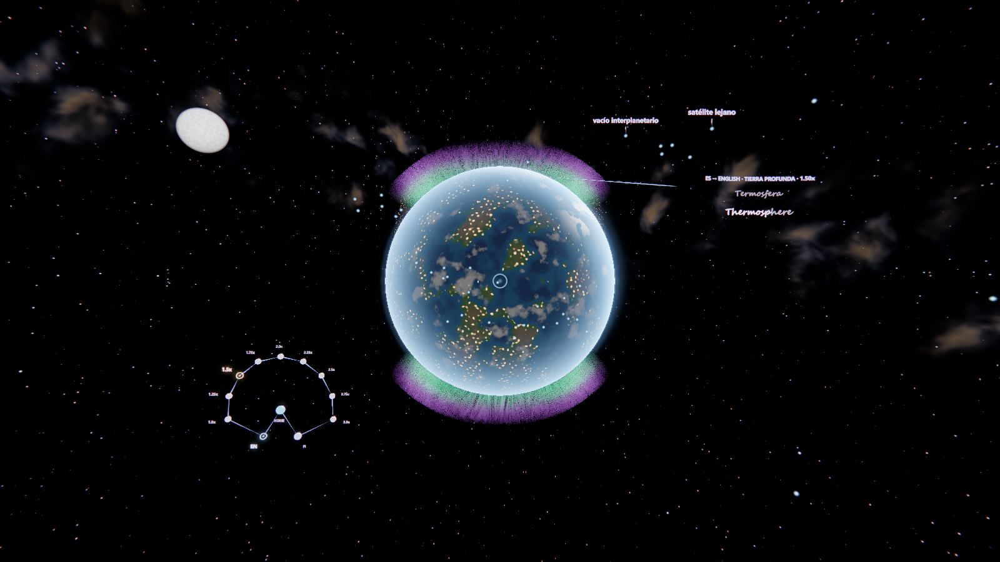
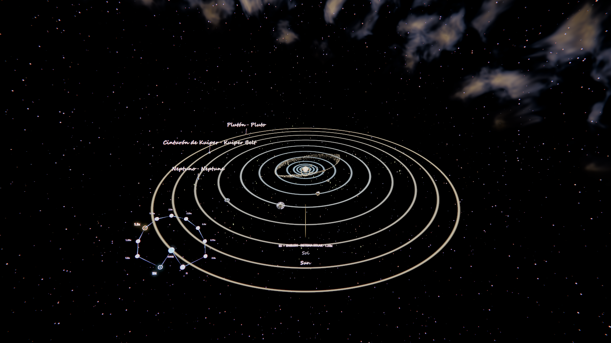
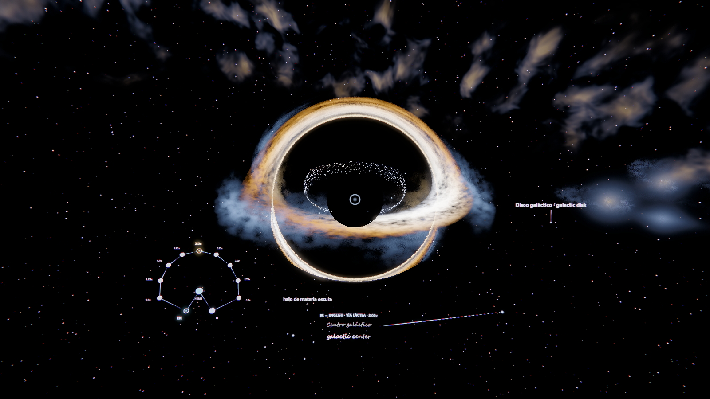
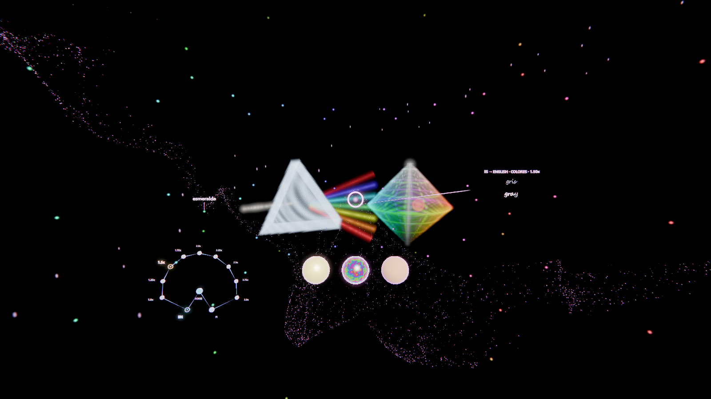
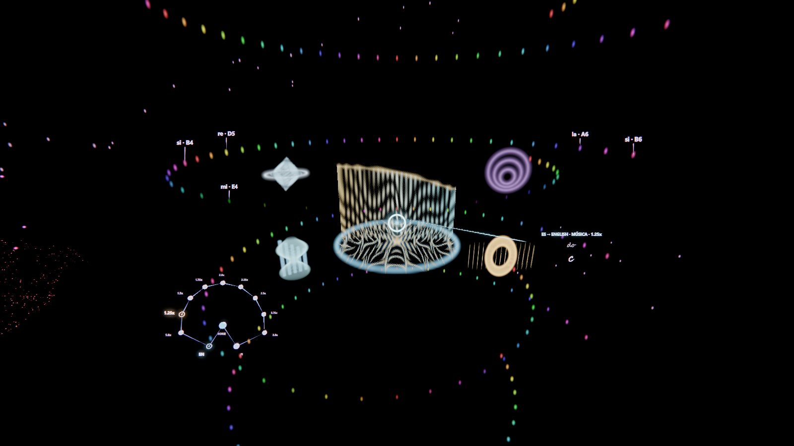
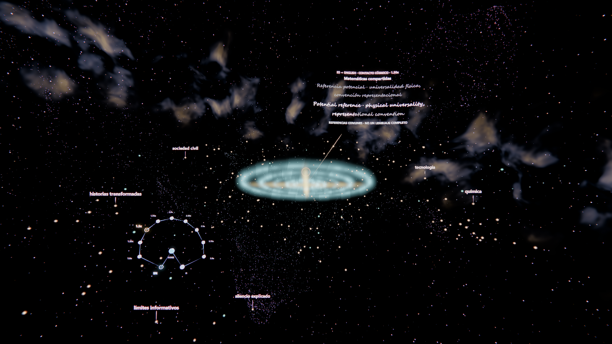

# HyperCosmosVR

**Continuous 3D Multi-Scale VR & Desktop HDR Cosmos (`10⁻³⁶ m` Planck Foam to `10⁺³⁰ m` Hyper-Horizons) — Native Rust, DirectX 12, OpenXR Stereo Multiview, Zero 2D UI, and Bilingual Live-Ink Narration**

[](LICENSE-MIT)
[-orange.svg)](Cargo.toml)
[](docs/platform_spec.md)
[](https://github.com/RONITERVO/HyperCosmosVR/actions/workflows/ci.yml)

**HyperCosmosVR** unifies all **25 documentary experiences** from [RONITERVO/Spanish-Quick-Apps](https://github.com/RONITERVO/Spanish-Quick-Apps) and [RONITERVO/Spanish-Quick-Apps-audio](https://github.com/RONITERVO/Spanish-Quick-Apps-audio) into one boundaryless, pure-`#000000` OLED 3D simulation. There are **no 2D menus, no HUDs, no loading screens, and no teleport cuts**: you fly freely from quantum spin-foam up through Earth's interior, the Solar System, cosmic web filaments, emergence of mind/music/civilization, and philosophical horizon worlds. When you pause in space, the cosmos illuminates the subject and speaks in **Spanish** with word-synchronized 3D calligraphy and **English / Finnish** translations.

---

## Navigation by Role

| If you are evaluating or working on... | Jump directly to... |
| :--- | :--- |
| **Product / Education / Content (Non-Technical)** | [Verified Facts at a Glance](#verified-facts-at-a-glance) · [Quick Start (2 Minutes)](#quick-start-windows-x64) · [Controls](#controls-desktop--vr) · [Adaptation Guide](docs/CUSTOMIZATION.md) |
| **Visual Design & UX** | [Visual Gallery (OLED Verified)](#visual-gallery-verified-headless-rtx-5070-renders) · [Zero-2D-UI Design](docs/universe_architecture.md) · [Font Swapping](assets/fonts/README.md) |
| **Engineering (Graphics, VR, Audio, Data)** | [10-Crate Architecture](#10-crate-workspace-architecture) · [Shader Contracts](shaders/SHADER_CONTRACTS.md) · [Platform Spec](docs/platform_spec.md) · [Catalog Spec](docs/catalog_spec.md) |
| **Corporate Legal / Security / Supply Chain** | [License & Compliance](#license-supply-chain--attribution) · [`THIRD_PARTY_NOTICES.md`](THIRD_PARTY_NOTICES.md) · [`SECURITY.md`](SECURITY.md) |

---

## Verified Facts at a Glance

Everything in this table reflects directly measured outputs, file sizes, compiler telemetry, and test assertions in this repository (`Cargo.toml`, `crates/cosmos_manifest/tests/manifest_tests.rs`, `artifacts/verification_renders/benchmark_sweep.txt`, and `docs/catalog_spec.md`):

| Category | Verified Fact | Source / How Verified |
| :--- | :--- | :--- |
| **Experiences & Content** | **`25` experiences** (`01..25`), **`376` zones**, **`2,456` features**, **`6,415` key entries**, **`11` Solar System bodies**, **`31` galactic landmarks**, **`12` musical notes × `4` timbres** | `universe_catalog.v1.json` & `manifest_tests.rs` |
| **Bilingual SyncVoice Audio** | **`18,898` audio assets** (`6,068 es-ES`, `6,415 en-US`, `6,415 fi-FI`) + **`148,045` UTF-8 word-timing cues** | `manifest_tests.rs` (`real_mmap_catalog_and_audio_pack_verify_all_18898_assets`) |
| **Scale Range** | Continuous `f64` floating-origin coordinates across **`u = -36.0` to `+30.0`** (`10⁻³⁶ m` to `10⁺³⁰ m`), opening at Earth Low Orbit **`u = +6.6`** | `crates/cosmos_nav/src/flight.rs` |
| **Rest-to-Learn FSM** | `Moving -> Settling (0..200 ms) -> Locked (200..900 ms) -> Narrating -> Complete`, with `region-heading` & `shared-context` skip memory | `crates/cosmos_narration/src/fsm.rs`, `memory.rs` |
| **Pitch-Preserving Speed** | `9` discrete rates **`1.0×` to `3.0×`** (`0.25×` steps) via `wsola 0.3.0` + `rubato 5.1.0` + IRCAM HRTF (`irc_1040_c.bin`) at `48 kHz` WASAPI | `crates/cosmos_audio/`, `assets/hrir/irc_1040_c.bin` |
| **Measured GPU Performance** | **RTX 5070 DX12 (`1600×900`, `120`-frame sweep across `u=[-35..+28.5]`): `min = 0.852 ms`, `mean = 1.927 ms (518.9 FPS)`, `p99 = 4.873 ms`, `max = 5.467 ms`** | `artifacts/verification_renders/benchmark_sweep.txt` |
| **OLED Void & Highlight Check** | **`42` headless verification PNGs**: `>= 50.91%` genuine `#000000` black pixels (`min` in `06_cmb_and_inflation.png`) and **`0.0000%` highlight blowout** (`R/G/B == 255`) | `artifacts/verification_renders/*.png` |
| **Graceful Audio Fallback** | If the optional **`1.05 GiB`** `universe_audio.hcvp` release pack is not downloaded, the app automatically boots in **visual + spatial synth mode** | `crates/cosmos_app/src/assets.rs` |
| **Verified Platform Scope** | Built & verified on **Windows 11 x64 (`x86_64-pc-windows-msvc`), AMD Ryzen 9 7950X, NVIDIA RTX 5070 (DX12 `DynamicDxc`), OpenXR static loader (`SteamVR` / `Oculus` / `VirtualDesktopXR`)** | `docs/platform_spec.md` |

> **Scope Honesty Note:** Linux/macOS targets, non-DX12 GPUs, and live optical tests inside physical HMDs beyond the OpenXR runtime & DX12 stereo swapchain pipeline are **not** verified in CI. GitHub Actions CI runs `cargo clippy --workspace --all-targets -- -D warnings` plus hardware-independent unit and `.hcvb` schema tests on `windows-latest`, while GPU rendering and 18,898-MP3 verification run locally on Discrete DX12 hardware.

---

## Visual Gallery (Verified Headless RTX 5070 Renders)

All 42 full-resolution PNG screenshots are checked into [`artifacts/verification_renders/`](artifacts/verification_renders/) for fast visual review:

<table>
  <tr>
    <td width="50%" align="center">
      <br/>
      <sub><b>Cold Start (`u = +6.6`)</b> — Earth Low Orbit, Volumetric Aurora & Instant Presence (zero 2D HUD)</sub>
    </td>
    <td width="50%" align="center">
      <br/>
      <sub><b>App 04 · Solar System (`u = +9..+13.5`)</b> — Cassini Rings & Procedural Planetary PBR</sub>
    </td>
  </tr>
  <tr>
    <td width="50%" align="center">
      <br/>
      <sub><b>App 04 · Heliocentric Panorama</b> — Sun & Outer Planets with True `#000000` OLED Void</sub>
    </td>
    <td width="50%" align="center">
      <br/>
      <sub><b>App 05 · Milky Way (`u = +13.5..+21`)</b> — Sgr A* Relativistic Accretion & Galactic Disk</sub>
    </td>
  </tr>
  <tr>
    <td width="50%" align="center">
      <br/>
      <sub><b>App 01 · Volumetric Color Prism</b> — Continuous 3D HSL Bicone & Spanish Lexicon</sub>
    </td>
    <td width="50%" align="center">
      <br/>
      <sub><b>App 02 · Cymatic Sanctuary</b> — 48-String Plucked Harp, Chladni Nodes & 4 Timbres</sub>
    </td>
  </tr>
  <tr>
    <td width="50%" align="center">
      <br/>
      <sub><b>App 17 · Mind</b> — Sculpted 3D Anatomical Cortex & Luminous Connectome</sub>
    </td>
    <td width="50%" align="center">
      <br/>
      <sub><b>App 22 · Cosmic Contact</b> — Deep-Space SETI Dish & Interstellar Signal Cones</sub>
    </td>
  </tr>
</table>

---

## Quick Start (Windows x64)

### 1. Prerequisites
- **Windows 10 / 11 (x64)** with a DirectX 12 GPU
- **Rust toolchain (`stable`, `rustc 1.92+`)** — [rustup.rs](https://rustup.rs)
- **Visual Studio 2022+ (or Build Tools)** with **Desktop development with C++** + **CMake** and **Windows 10/11 SDK** (`dxcompiler.dll` & `dxil.dll`)

### 2. Clone & Launch Immediately (Visual + Spatial Synth Mode)
```powershell
git clone https://github.com/RONITERVO/HyperCosmosVR.git
cd HyperCosmosVR
.\Start-HyperCosmosVR.cmd --desktop
```
`Start-HyperCosmosVR.cmd` automatically:
1. Locates Visual Studio's CMake if not on `PATH`.
2. Copies Windows SDK `dxcompiler.dll` / `dxil.dll` and locally stages your OS font files into `assets/fonts/` (`tools/stage_runtime_deps.ps1`).
3. Builds `cosmos_app` (`--release`), bakes the MSDF 3D text atlas on first boot, and launches straight into **Earth Low Orbit (`u = +6.6`)** (or attaches to your OpenXR VR headset if running without `--desktop`).

### 3. Enable Full Spoken Spanish + EN/FI Narration (`1.05 GiB`, Recommended)
To download and SHA-256-verify all `18,898` MP3 narration recordings (`assets/baked/universe_audio.hcvp`) from GitHub Release `v0.1.0`:
```powershell
powershell -NoProfile -ExecutionPolicy Bypass -File tools\fetch_audio_pack.ps1
```
Then run `.\Start-HyperCosmosVR.cmd` normally.

### CLI Options (`cosmos_app`)
```text
cosmos_app.exe [OPTIONS]
  --desktop                    Force Desktop HDR window even when OpenXR is active
  --hdr-surface                Prefer Rgba16Float HDR desktop swapchain when supported
  --headless-render <out_dir>  Render verification viewpoints headlessly into <out_dir>
  --benchmark-sweep            Run the 120-frame multi-scale performance sweep
  --width <px> --height <px>   Override headless output resolution (default 1600x900)
```

---

## Controls (Desktop & VR)

| Action | Desktop Controls | VR (OpenXR 6DoF + Hand Tracking) |
| :--- | :--- | :--- |
| **6DoF Space Flight** | `W`/`S` forward/back · `A`/`D` strafe · `E`/`Q` up/down · `Z`/`C` roll · `Shift` boost | Thumbstick locomotion + two-hand pinch scale-dive |
| **Look / Orbit** | Hold `F` or `Left` / `Right` mouse drag | Natural HMD head orientation & gaze |
| **Logarithmic Scale Dive** | Mouse `Scroll` (zooms continuously toward cursor ray) | Two-hand span gesture or grip-pull along focus ray |
| **Trigger Narration** | Come to rest on any cosmic feature (`900 ms` dwell) | Gaze or hand ray dwell (`900 ms`) |
| **3D Wrist Resonance Ring** | Hold `Right Mouse` or press `Tab` (`[`/`]` or `-`/`=` speed, `L` EN/FI) | Turn non-dominant palm upward (`r = 7.5 cm` spatial ring) |
| **Return to Earth Orbit** | `Home` (continuous spline fly-back) | Touch central Earth pearl on Wrist Ring |
| **Exit** | `Escape` | Exit via OpenXR system menu |

---

## Adapting & Customizing HyperCosmosVR

Need to brand fonts, adjust narration timings, deploy to a kiosk without internet access, or rebuild the universe catalog from your own content fork?

See **[docs/CUSTOMIZATION.md](docs/CUSTOMIZATION.md)** for step-by-step recipes:
- Swap display & UI fonts cleanly ([`assets/fonts/README.md`](assets/fonts/README.md)) without editing shaders or code.
- Point the binary at an external asset folder via `HYPERCOSMOS_ROOT`.
- Tune Rest-to-Learn dwell thresholds (`FsmConfig`), cold-start pose (`COLD_START_SCALE_EXP`), or per-experience HDR accents (`experience_accent_linear`).
- Re-bake `.hcvb`, `.hcvp`, and `.v1.json` from custom upstream directories via `tools/bake_universe.py --sqa-root ... --sqaa-root ...`.

---

## 10-Crate Workspace Architecture

```
crates/
├── cosmos_math       # f64 SectorId floating-origin coordinates, Reversed-Z projections, scale splines
├── cosmos_manifest   # Zero-copy mmap loader + CRC32 validation for universe_catalog.hcvb & .v1.json
├── cosmos_spatial    # Continuous 25-experience manifold topology, octree culling & scale shells
├── cosmos_narration  # Rest-to-Learn FSM, region-heading/shared-context skip memory, SyncVoice cues
├── cosmos_nav        # 6DoF damped flight physics, magnetic approach throttling, Home spline
├── cosmos_typo       # fdsm MSDF glyph atlas baker + world-space live-ink layout engine
├── cosmos_audio      # symphonia MP3 -> wsola (1x–3x) -> rubato 48kHz -> IRCAM HRTF + fundsp synth
├── cosmos_render     # wgpu 30 DX12 DynamicDxc renderer: compute, far shell, 6-module hero SDF, AgX
├── cosmos_xr         # Static OpenXR D3D12 LUID-pinned stereo session + XR_EXT_hand_tracking
└── cosmos_app        # Unified entrypoint: OpenXR VR, Desktop HDR winit loop, Headless benchmark/QA
```

### Multi-Pass HDR & OLED Rendering Pipeline (`shaders/`)
All passes share camera-relative coordinates (`(0,0,0)` at head midpoint) and a Reversed-Z infinite far plane (`near = 1.0`, `inf = 0.0`). Every render shader compiles both desktop mono (`vs_main`) and stereo multiview (`vs_stereo`) entry points:
1. **`compute_universe.wgsl`**: Advects multi-mode cosmic particles and 2D ping-pong PDE grids.
2. **`far_shell.wgsl`**: Infinite sky dome (deep starfield, Milky Way dust lanes, CMB sphere, inflation glow, quantum void, hyper-horizon lotus).
3. **Concatenated Hero Volumetric Pipeline** (`common_oled.wgsl` -> `doc_common.wgsl` -> `hero_doc_cosmos.wgsl` -> `hero_doc_matter_mind.wgsl` -> `hero_doc_civilization_horizon.wgsl` -> `hero_volumetric.wgsl`): Raymarched planetary interiors, Cassini/Goldilocks rings, relativistic Kerr black hole, 3D HSL prism, Chladni harp, DNA/cell, anatomical brain connectome, orbital compute rings, Dyson/SETI worlds, and horizon lotus wings.
4. **`instanced_sprites.wgsl`**: Zero-VB procedural luminous stars, filaments, asteroids, spectrograph/DNA barcodes, diegetic Wrist Ring pearls, and cones.
5. **`msdf_text.wgsl`**: Obsidian-halo 3D world-space MSDF live-ink glyphs with glowing nib sweep and tether arcs.
6. **`post_bloom_agx.wgsl`**: Thresholded (`>= 1.05`) Dual-Kawase bloom, Troy Sobotka AgX OLED tonemap, `#000000` black gate, and `128×128` RGB blue-noise TPDF dither.

---

## Development, Testing & CI

```powershell
# Lint & static checks across all 10 crates + targets (enforced in CI)
cargo clippy --workspace --all-targets -- -D warnings

# Hardware-independent unit & catalog checks (runs cleanly in GitHub Actions without GPU/audio pack)
cargo test -p cosmos_math -p cosmos_narration -p cosmos_nav -p cosmos_xr
cargo test -p cosmos_spatial topology
cargo test -p cosmos_manifest --test manifest_tests real_catalog_matches_v1_json_metadata_and_crc32

# Full local verification suite (requires Discrete DX12 GPU, staged fonts, and universe_audio.hcvp)
cargo test --workspace -- --test-threads=1
```

See **[CONTRIBUTING.md](CONTRIBUTING.md)** for full setup, PR review standards, and shader guidelines.

---

## License, Supply Chain & Attribution

- **Source Code (`crates/`, `shaders/`, `tools/`, `docs/`):** Dual-licensed under **[MIT](LICENSE-MIT) OR [Apache-2.0](LICENSE-APACHE)** (`Cargo.toml`).
- **Third-Party Dependency & Copyleft Disclosure:** Direct Rust crates, exact versions, and SPDX licenses — including **`symphonia 0.6.1` (`MPL-2.0`)** and **IRCAM `irc_1040_c.bin` (`MIT OR Apache-2.0` via `firewheel-ircam-hrtf`)** — are audited in **[THIRD_PARTY_NOTICES.md](THIRD_PARTY_NOTICES.md)**.
- **Font Exclusion Notice:** Windows system `.ttf` fonts (`Segoe UI`, `Segoe Script`, `Segoe UI Symbol`) carry proprietary Microsoft copyrights and are excluded from this repository; `tools/stage_runtime_deps.ps1` copies them strictly from your local Windows installation.
- **Content Provenance:** Documentary scripts, bilingual Spanish/English/Finnish audio, and SyncVoice timestamps (`universe_catalog.*`, `universe_audio.hcvp`) are baked from [RONITERVO/Spanish-Quick-Apps](https://github.com/RONITERVO/Spanish-Quick-Apps) and [RONITERVO/Spanish-Quick-Apps-audio](https://github.com/RONITERVO/Spanish-Quick-Apps-audio).
- **Security & Conduct:** See [SECURITY.md](SECURITY.md) and [CODE_OF_CONDUCT.md](CODE_OF_CONDUCT.md).

