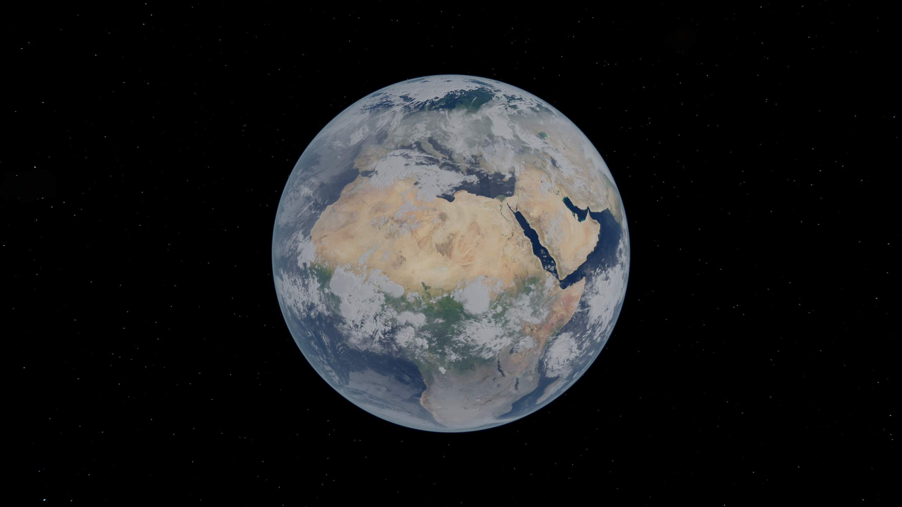

# Earth presence and fidelity review

This change deepens the opening Earth chapter and fixes the coordinate and color
errors that made stable environments read as miniature, washed-out exhibits.
It does not establish a documentary-quality score or complete every Earth lesson.

## Implemented behavior

- Source-based 8K geography, night lights, relief and cloud coverage, with separate
  surface, elevated cloud, shadow and atmospheric shading. See the
  [source record](../../assets/textures/earth/README.md) for dates, credits,
  sampling limits and the older polar cloud fill.
- Six physical observing positions: home, daylight geography, cloud horizon,
  a close encounter with the incoming solar wind, the full magnetic environment,
  and the southern aurora. The repeating event connects arrival, deflection,
  tail release, earthward transport, precipitation and auroral response.
- Fixed world geometry, physical Earth/Moon scale, meter-valued headset
  translation and IPD, and independent room-scale holographic controls.
  Static observations retain their camera pose through sentence boundaries.
  Looking away retains the current orbital experience. An authored cut separates
  the physical Earth chapter from the normalized Solar System model; orbital
  approaches within the Earth chapter follow arcs outside the planet.
- Correct AgX output linearization, verified against independent reference
  values and both hardware/manual sRGB targets. This changes every SDR scene.
- Tour and selector viewpoints follow the same fixed stage anchors and extents
  as rendering, including real Solar System bodies and galactic landmarks.

The invisible field and particle traces are explanatory graphics in world space.
The centered dipole, exaggerated trace visibility and accelerated 16-second
sequence are illustrations, not measured space weather or a numerical MHD model.
Cloud transport is also authored. Local soil, forest exchange, condensation,
coastal evolution and several older altitude overlays remain unfinished lessons;
the [Act I map](../../docs/roadmap/ACT_1_EARTH_AND_SOLAR_SYSTEM_MAP.md) records these
limits explicitly.

## Review evidence

Three caption-free, muted 16-second clips retain both eyes side by side, at
1280×720 per eye and 30 simulation frames per second:
[incoming solar wind](motion/incoming-wind-stereo.mp4),
[magnetic transport](motion/magnetic-environment-stereo.mp4), and
[auroral response](motion/aurora-stereo.mp4).
They use the final shader and one complete shared event cycle. The transport
progresses from the sunward stream through the sheath and tail, then back toward
Earth and down the polar branches; the aurora responds later in the same cycle.
Frames were captured independently and encoded with FFmpeg/libx264, CRF 17,
without overlays, color grading or interpolation. The images and sampled motion
frames were inspected in both eyes; a viewer's unaided explanation remains a
human acceptance check. Timing in [the sequence log](motion/capture.txt) includes
idle gaps between frames and should not be compared with the consecutive bursts.

The [1440p stereo capture](stereo_1440p/capture.txt) uses the shipped camera poses,
64 mm IPD, 120 consecutive frames per stop, eight warmup frames, and simulation
time 9.200–13.167 seconds. Both unmodified eye images are retained for every stop.

| Stop | Left eye | Right eye | Mean / p95 submission + GPU wait (ms) |
|---|---|---|---|
| Home | [Image](stereo_1440p/exp03_z000_space/eye0_0119.png) | [Image](stereo_1440p/exp03_z000_space/eye1_0119.png) | 3.907 / 4.356 |
| Daylight geography | [Image](stereo_1440p/earth_daylight_ocean/eye0_0119.png) | [Image](stereo_1440p/earth_daylight_ocean/eye1_0119.png) | 4.089 / 4.489 |
| Cloud horizon | [Image](stereo_1440p/earth_cloud_horizon/eye0_0119.png) | [Image](stereo_1440p/earth_cloud_horizon/eye1_0119.png) | 5.230 / 5.617 |
| Incoming solar wind | [Image](stereo_1440p/earth_solar_wind/eye0_0119.png) | [Image](stereo_1440p/earth_solar_wind/eye1_0119.png) | 9.436 / 9.740 |
| Magnetic environment | [Image](stereo_1440p/earth_magnetic_deflection/eye0_0119.png) | [Image](stereo_1440p/earth_magnetic_deflection/eye1_0119.png) | 4.985 / 5.441 |
| Aurora | [Image](stereo_1440p/earth_auroral_response/eye0_0119.png) | [Image](stereo_1440p/earth_auroral_response/eye1_0119.png) | 9.596 / 10.127 |

The aurora's previous procedural implementation measured 42.716 / 49.386 ms in
the same burst configuration. A periodic compute lookup and analytic gradients
retain all three curtains, 56 integration intervals and two crossing refinements.
Against the previous final-frame images, each eye has mean absolute channel
error below 0.015 on an 8-bit scale. Within the visible green aurora, the 95th
percentile maximum-channel difference is 1 and the 99th is 5; sparse sharp
features differ more. This is close agreement, not pixel identity. It does not
establish absence of headset shimmer.



The [3400×3468-per-eye reference](stereo_3400x3468.txt) repeats that burst at the
dimensions previously reported by SteamVR for this PSVR2. Mean / p95 times are
13.310 / 13.917 ms (home), 15.025 / 15.392 (daylight), 16.516 / 16.861 (clouds),
30.491 / 30.906 (incoming wind), 18.181 / 18.673 (field), and 28.755 / 29.597
(aurora). Both reference sizes use a synthetic symmetric 72° vertical field of
view, not the headset's native asymmetric projections. They omit application
simulation, room controls and the compositor. These results are useful rendering
comparisons; they are not measured headset FPS or proof of a native 30 FPS floor.

## Reproduction

Run from the repository root with the normal local catalog, fonts and optional
narration pack installed. These review images contain no captions or UI.

```powershell
# Six stereo views, 120 consecutive timed frames each, final frame saved.
cargo run --release -p cosmos_app --example earth_review -- target/earth_review_burst 2560 120 all 9.2 1440 0

# Full 16-second stereo motion sequence, at 30 simulation frames per second.
cargo run --release -p cosmos_app --example earth_review -- target/earth_review_motion 1280 480 earth_solar_wind,earth_magnetic_deflection,earth_auroral_response 0

# Fast checks before creating any full documentary GPU pipelines.
cargo test --release -p cosmos_render --lib shader_validation
cargo test --release -p cosmos_render --test post_color_tests

# Complete local suite, parallel correctness and isolated timing checks.
powershell -NoProfile -ExecutionPolicy Bypass -File tools/test_local.ps1 -Release
```

`capture.txt` records the adapter, exact eye dimensions, initialization time,
capture policy, simulation interval and CPU submission/wait timing. The burst
mode avoids readback/PNG gaps between timed frames. It is an offscreen stereo
reference, not native headset GPU timing, application FPS or a compositor result.
Continuous video and both-eye inspection complement the numerical checks;
neither proves a viewer's comfort or understanding.

## Hardware acceptance

Reference workstation: RTX 5070 and Ryzen 9 7950X. The user's headset reference is
PSVR2 at 120 Hz with SteamVR's automatically recommended eye resolution, alongside
higher-end OLED headsets. The requested planning tiers are 30/90/120 application
FPS and 1440p–4K reference resolutions; display refresh and synthesized/repeated
frames must be reported separately.

SteamVR was observed in standby during this review. Physical headset acceptance
and a new native/compositor measurement remain pending unless a later record in
this directory explicitly documents them. No SteamVR resolution setting was
changed, and no automatic quality reduction was added.

## Automated validation

- CPU framing checks cover all 3,011 built-in Odyssey stops and all 38 non-Earth
  Highlights stops, and compare the shipped Highlights JSON with the actual
  runtime catalog export. The six deliberately off-center Earth observations
  have separate camera, route and physical-presence regressions.
- All 16 renderer regressions pass with four test threads (161.46 seconds),
  including the full catalog, Life's 153 features, stereo and physical-scale
  checks. Brightness and feature-distinctness thresholds remain enforced.
- The CPU WGSL/embedded-map library checks pass in 0.76 seconds; the independent
  final-color GPU regression passes in 0.61 seconds. These are release test
  execution times after compilation, without full documentary pipeline startup.
- All 14 typography tests pass in 1.11 seconds, isolated from competing work.
- All 18 application CPU tests pass after the final transition changes (3.89
  seconds), including all six Earth stops with a 180° head turn. All eight journey
  tests pass, including zero/tiny-delta chapter cuts and one narration arrival.
- All three application integration checks pass: cold-start controls/audio,
  the 25-experience scene sweep with 120-frame benchmark, and welcome/help/tour/
  stereo guidance. The depth fixture now uses an explicit room-scale opaque
  sphere; it retains its greater-than-1,000 changed-pixel assertion. It no longer
  attempts to bring a planet in front of nearby controls by scaling one axis.
- Workspace Clippy passes with `-D warnings`; app/render doc checks pass.
  CPU math, navigation, narration, audio, catalog, spatial and XR checks pass.
  No tracked proprietary fonts, machine-specific Cargo config or files over
  50 MiB were introduced.

The application captures include [desktop welcome](application/welcome.png),
the VR hologram's [left](application/vr_hologram_eye_0.png) and
[right](application/vr_hologram_eye_1.png) eyes, and the leaned
[left](application/vr_hologram_lean_eye_0.png) and
[right](application/vr_hologram_lean_eye_1.png) views. The
[2048×2048 stereo reference](application/stereo_timing.txt) records 3.647 ms
mean / 4.272 ms maximum with text visible over 30 frames. This is an offscreen
control-rendering check, not a native headset result.

Whole-frame black-pixel quotas have been replaced where a legitimate subject
fills the frame. Empty-space patches and a fully empty HDR/postprocessing probe
still require exact OLED black, while brightness and highlight checks remain.
The test runner includes the new CPU tour-framing phase before GPU work.
