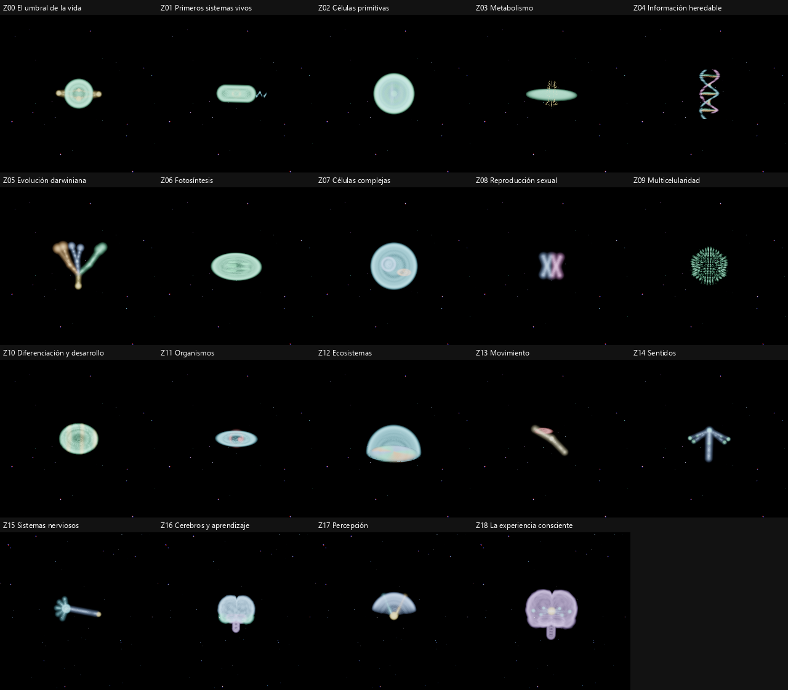
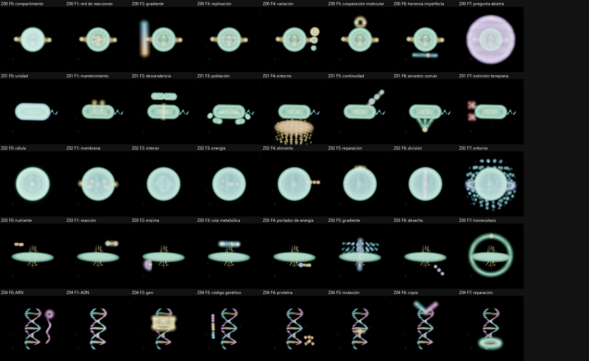
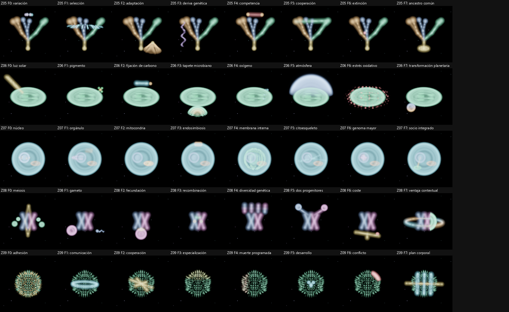
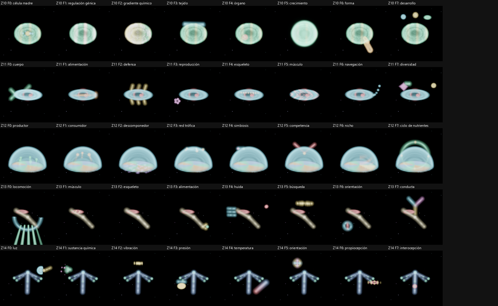
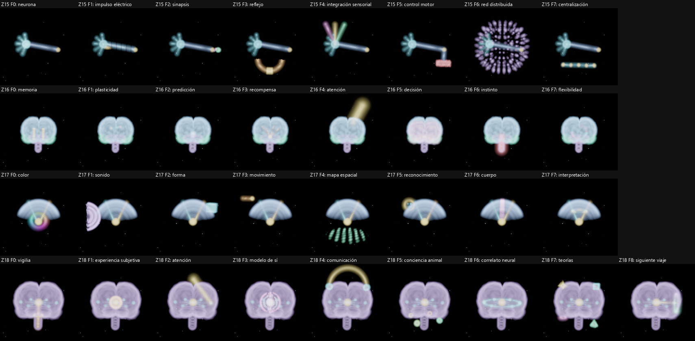

# Life visual verification — 2026-11-15

Experience 16 now routes all 19 zones (`2600..=2618`) and 153 catalog features through `shade_doc_life_stage`, including the ninth feature at Z18. The four Life packages bring the roadmap to 47/85 completed content packages, 204/376 zones, and 1,273/2,456 features.

## Validation

- Windows DX12 on NVIDIA GeForce RTX 5070; workspace suite: **99 passed, 0 failed**. Clippy with `-D warnings`: passed.
- Life GPU matrix: **172 renders** (153 features + 19 overviews), 256×256, 28 raymarch steps maximum. Minimum exact black: **87.80%** (gate ≥50.91%); minimum lit pixels: **1054** (gate ≥450); clipped RGB channels: **0 pixels**.
- Every pair of features within each zone differs by at least 120 pixels (RGB difference ≥4). Every pair of zone overviews differs by at least 400 pixels; measured minimum: **1906**. Particle budget is zero and companion spheres are removed from these image comparisons, after their routing is asserted.
- Narration test reads the baked catalog and verifies all 153 feature indices, including Z18 F8, plus Spanish/English biological and neural cue tags.
- Full application showcase: **43 renders**, 1600×900; minimum exact black **56.15%** (`06_cmb_and_inflation.png`); clipped RGB channels **0 pixels**. Refreshed the two Life showcase PNGs in `../verification_renders/`.
- 88 unique package anchors, no broken local links in changed docs, no tracked font binaries or files over 50 MiB.

The [benchmark sweep](benchmark_sweep.txt) measures CPU+GPU frame cadence across 120 scale-sweep frames; it is not a physical-headset measurement. The contact sheets support visual review; pixel-difference checks establish distinct rendered states, not learner comprehension.

## Local test throughput

The serial debug workspace command completed in **948.59 seconds** (log creation to final write). The new [`tools/test_local.ps1`](../../tools/test_local.ps1) completed the same **99 tests in 536.22 seconds**, including Cargo overhead, on this machine. Both runs used the default debug test profile with incremental compilation disabled for this sandbox. The runner uses 32 CPU test threads and four concurrent DX12 correctness tests, warms the shared font cache once, and runs typography latency checks and the application benchmark in separate serial phases. Every workspace test runs once; failures stop the script. `-CpuThreads`, `-GpuThreads`, and optional `-Release` allow local tuning.

The end-to-end reduction was **43.5%** (1.77× throughput). Timing comparisons from these two runs:

| Measurement | Serial | Parallel runner |
|---|---:|---:|
| Full run, including Cargo overhead | 948.59 s | 536.22 s |
| DX12 correctness test body | 483.41 s | 191.93 s |
| Isolated application integration test body | 160.00 s | 160.84 s |

## Review images



Feature sheets show centered 128×128 crops from the unmodified 256×256 captures, enlarged for inspection. OLED measurements above use the full original frames.






| Zone | Features | Minimum black (including overview) | Minimum lit pixels | Minimum feature-pair difference |
|---|---:|---:|---:|---:|
| Z00 threshold | 8 | 87.80% | 2245 | 398 |
| Z01 firstlife | 8 | 91.71% | 1893 | 1175 |
| Z02 cells | 8 | 88.56% | 3632 | 360 |
| Z03 metabolism | 8 | 91.61% | 1586 | 351 |
| Z04 heredity | 8 | 95.72% | 1325 | 581 |
| Z05 evolution | 8 | 93.51% | 2758 | 309 |
| Z06 photosynthesis | 8 | 89.15% | 3085 | 279 |
| Z07 complexcells | 8 | 92.35% | 4796 | 467 |
| Z08 sex | 8 | 94.33% | 1733 | 1068 |
| Z09 multicellular | 8 | 94.06% | 2211 | 693 |
| Z10 development | 8 | 92.30% | 2667 | 419 |
| Z11 organisms | 8 | 95.64% | 1592 | 383 |
| Z12 ecosystems | 8 | 91.16% | 4456 | 637 |
| Z13 movement | 8 | 93.70% | 1054 | 423 |
| Z14 senses | 8 | 95.47% | 1554 | 349 |
| Z15 nervous | 8 | 90.07% | 1349 | 723 |
| Z16 brains | 8 | 93.29% | 2859 | 263 |
| Z17 perception | 8 | 94.23% | 2302 | 622 |
| Z18 consciousness | 9 | 89.42% | 5196 | 912 |

## Reproduce

```powershell
$env:HYPERCOSMOS_LIFE_CAPTURE_DIR = Join-Path $PWD 'target/life-verification'
cargo test -p cosmos_render --test render_tests life_all_zones_features_and_overviews_render_distinctly -- --exact
cargo test -p cosmos_narration life_catalog_features_keep_their_indices_and_bilingual_cues
cargo clippy --workspace --all-targets -- -D warnings
powershell -NoProfile -ExecutionPolicy Bypass -File tools/test_local.ps1
cargo run --release -p cosmos_app -- --headless-render target/life-showcase --benchmark-sweep
```

Next roadmap stop: `17_mind`, followed by the Colors and Music spatial labs. Core P0 catalog/CI work remains separately tracked in the master roadmap.
