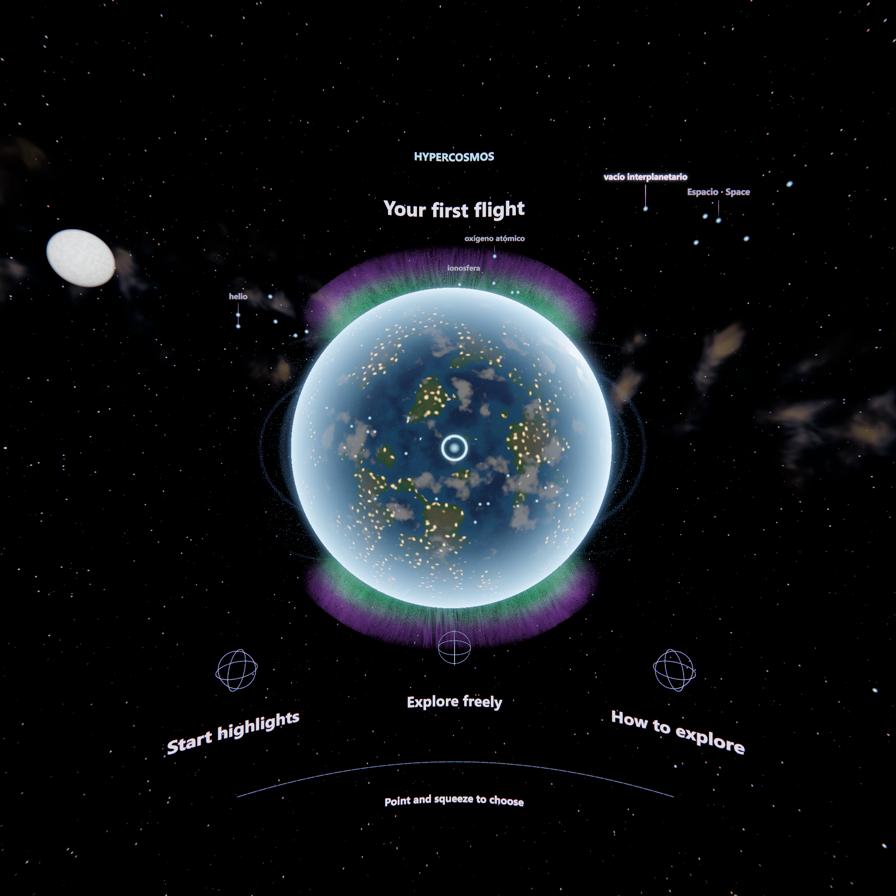
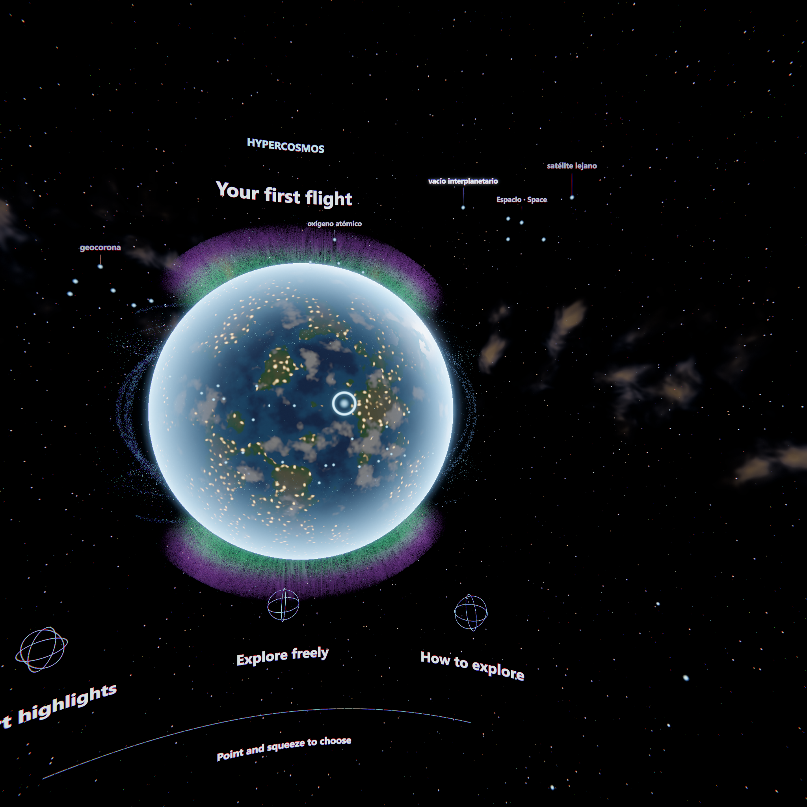

# VR presence, first-use guidance, and tour controls

Acceptance target: PSVR2 at **120 Hz**, using SteamVR's recommended per-eye resolution without application downscaling. Other high-end OLED headsets use their runtime's recommended resolution. A 120 Hz frame has an **8.333 ms** total budget; desktop frame timings and smaller offscreen renders do not establish headset performance.

The previous content PR completed Life and brought the visual roadmap to 47/85 content packages. This change addresses cross-experience usability and presence: startup had no visible guidance, controls were difficult to discover, pause exited playback, and the VR scene omitted room-scale head translation. Package completion measures implemented content coverage; it does not certify documentary-level visual richness or learner comprehension.

## Experience

- **VR:** a room-anchored holographic constellation of volumetric nodes and curved lettering. It uses ordinary scene depth, true binocular projection, and no rectangular backplates or foreground override. The introduction sits above Earth and the selection nodes below it, keeping the subject clear. Turning or leaning changes the view of the instrument. During tours, controls appear when the wrist interface is summoned. Pointer rays, hover emphasis, haptic feedback, and release-gated selection support deliberate interaction.
- **Presence:** head translation moves the world rendering independently of the tour rail. The audio listener uses the actual viewing orientation. Tracking/focus loss pauses a playing tour without automatically resuming it.
- **First use:** Start highlights, Explore freely, and How to explore; help includes the full Odyssey. English/Finnish instructions explain movement, narration, and the wrist controls. Autoplay launches directly into the selected tour.
- **Transport:** chapter and stop count, Previous, Pause/Resume, Next, Explore, and Restart at completion. Pause holds camera choreography, speech, and caption position. Seeking while paused stays paused and clears the previous clip. Closing help requires an explicit Resume. Explore preserves the current camera pose.
- **Desktop:** mouse controls have larger labels and dark contrast backplates. These backplates and their foreground rendering are desktop-only. F1 opens help; Space pauses/resumes; Escape closes help or returns to exploration; Alt+F4 quits.
- **Opening composition:** the built-in and shipped Highlights manifest now use the same Earth overview position as startup/Home. The prior tour-specific pose moved too close for the globe to fit the viewing angle. The overview test checks a 15–25 degree apparent half-angle.

## Rendered review

These are renderer-generated artifacts, not photographs through headset lenses. VR captures use the actual two-layer DX12 multiview path with a 64 mm IPD. The leaned view changes head translation and orientation while the hologram's tracking-space pose stays fixed.

| VR view | After leaning and turning |
| --- | --- |
|  |  |

[Right eye](vr_hologram_eye_1.png) · [Right eye after head movement](vr_hologram_lean_eye_1.png) · [Desktop welcome](welcome.png) · [Finnish help in a narrow window](help_fi.png) · [Corrected Earth overview](tour_paused.png) · [Desktop close-up contrast stress case](controls_close_up.png)

## Verification

The full local suite passed **104 tests in 696.96 seconds** (11m 37s), with 32 CPU test threads and four DX12 correctness threads. Application benchmarks and typography timings ran in isolation. After the final welcome composition and hidden-guide depth correction, the three focused guide/runtime tests passed again in the optimized build (1.52 seconds), followed by the actual mono/stereo guide integration test (62.49 seconds). The optimized application build and Clippy with `-D warnings` passed.

The runtime checks verify frozen camera/audio during pause, resume continuity, help/seek/exit transitions, pointer capture, room-anchored guidance, room-scale world movement, and held-trigger suppression. GPU typography checks cover normal depth occlusion and the desktop foreground path in mono and stereo. Both-eye captures preserve a majority of exact-black pixels and produce distinct eye perspectives.

The release desktop application was also exercised through its real window: click Start highlights, pause, seek while paused, open/close help, explicitly resume, exit to exploration, and return through the wrist Home node. These transitions produced the expected visible state, and the application closed cleanly.

| Full-suite phase | Seconds |
| --- | ---: |
| Asset cache warmup | 6.76 |
| CPU, catalog, audio and XR | 73.05 |
| Application correctness | 70.56 |
| DX12 correctness | 225.40 |
| Typography and cache timings | 16.88 |
| Application integration and benchmark | 300.31 |
| Application and renderer doc tests | 3.95 |

Reproduce on the configured Windows/DX12 workstation:

```powershell
$env:CARGO_INCREMENTAL = '0'
$env:HYPERCOSMOS_UX_CAPTURE_DIR = "$PWD/artifacts/ux_controls"
./tools/test_local.ps1
cargo clippy --workspace --all-targets -- -D warnings
# Regenerate the checked-in captures and reference timing with optimized CPU code:
cargo test -p cosmos_app --release --test integration_smoke spatial_guide_renders_welcome_help_and_close_up_tour_controls -- --exact --test-threads=1
```

The integration test records a **2048×2048-per-eye** reference with typography visible/hidden on the RTX 5070. Each measurement has four warmup frames followed by 30 samples. These are render submission plus GPU completion times, excluding the OpenXR compositor and simulation. The optimized build measured:

| Typography | Mean | Maximum |
| --- | ---: | ---: |
| Hidden | 6.186 ms | 7.089 ms |
| Visible | 6.298 ms | 7.247 ms |

[Raw measurement](stereo_timing.txt). The mean difference was 0.112 ms in this short reference run. Both cases fit within 8.333 ms **for this rendering-only workload**. The earlier unoptimized test binary measured approximately 9.3 ms. Neither result establishes end-to-end 120 Hz at the PSVR2's actual SteamVR recommendation, which may involve substantially more pixels.

The host OpenXR probe identified SteamVR/OpenXR but reported the headset unavailable. Physical headset comfort, lens clarity, real controller interaction, and frame timing at the actual recommended resolution remain unverified until a headset session is available.
