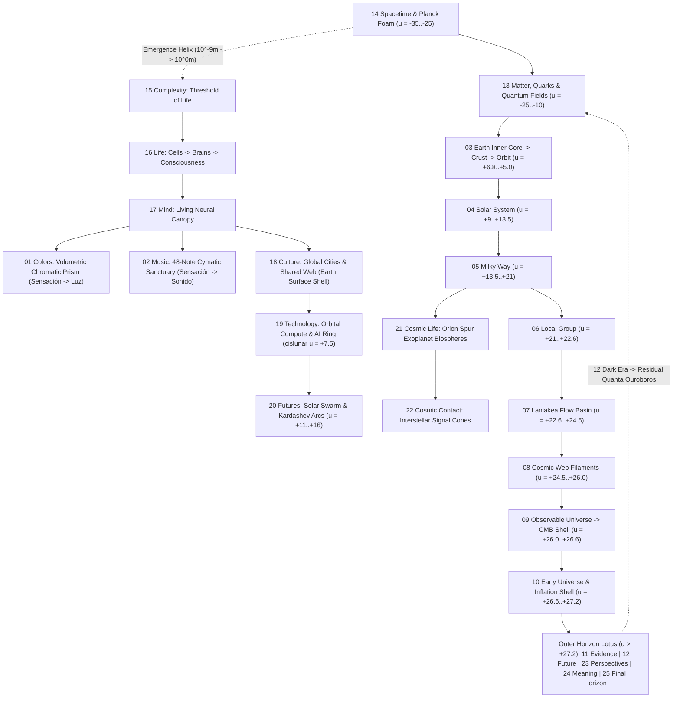
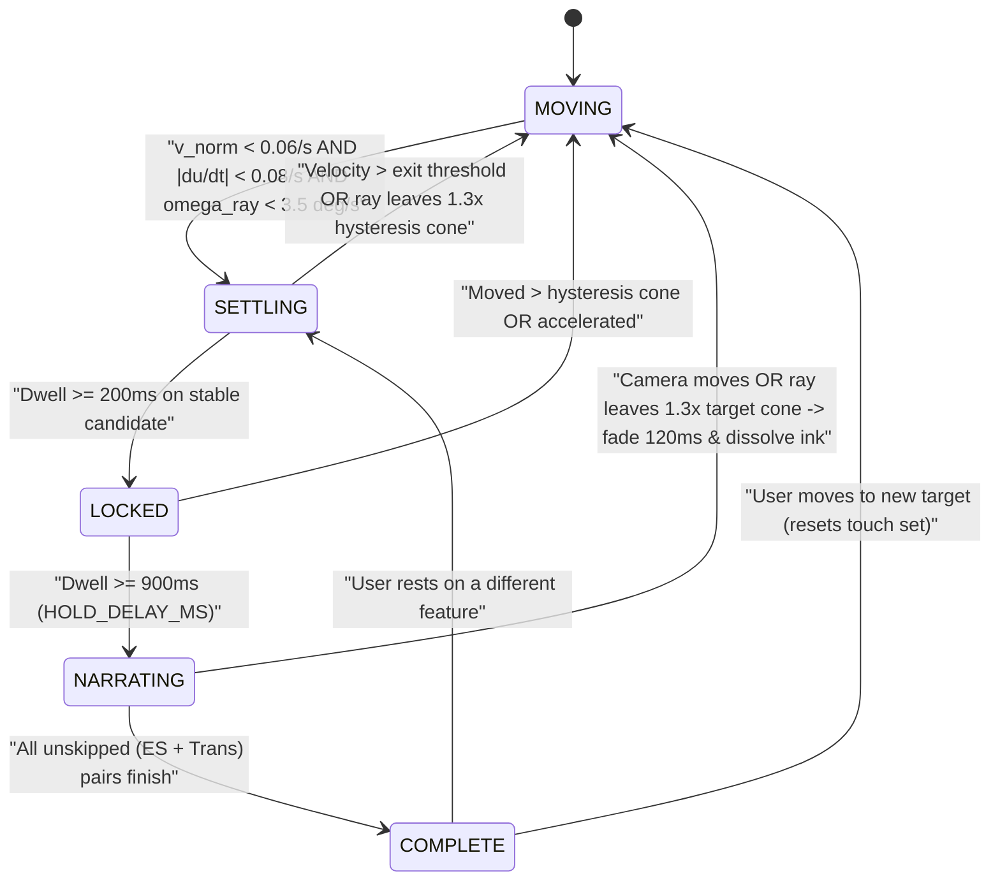

# HyperCosmosVR — Universe & AAA Visual/UX Architecture Blueprint

> **Design North Star:** *One seamless, boundaryless, pitch-black OLED 3D cosmos spanning over 62 orders of physical magnitude plus conceptual hyper-horizons — with ZERO 2D menus, ZERO 2D HUDs, ZERO loading screens, and ZERO cuts. You fly, scale-dive, and come to rest anywhere in existence; as you stop, the universe whispers in Spanish and writes living ink across space.*

---

## 1. Core Architectural Pillars & Ground-Truth Inheritance

HyperCosmosVR unifies all **25 experiences** from `Spanish-Quick-Apps` (`01..25`: **376 zones**, **2,456 features**, continuous HSL perceptual color naming, 48-note × 4-timbre musical synthesis, and **~19,245 SyncVoice bilingual audio/cue entries**) into a single continuous native VR + Desktop 3D engine targeting **90–120 Hz stereo VR on an NVIDIA RTX 5070**.

### Inherited Behavioral Contracts (Preserved 100%, Evolved to 3D VR)
1. **Rest-to-Learn Mechanics (`learning-narration.js`)**: Explanations never interrupt flight. Moving suppresses/dissolves active narration; coming to rest within an angular jitter tolerance for **`900 ms`** (`HOLD_DELAY_MS`, configurable `650–1100 ms`) triggers spatial narration.
2. **Region-Heading & Shared-Context Skip Memory (`shared-narration-memory.js`)**: Within the same `regionId`, unchanged `region-heading` and `shared-context` segments whose **Spanish + Translation** pair previously finished completely are remembered silently (soft ghosted translation in 3D space) and skipped on subsequent stops inside that region. Crossing into any new region resets the memory.
3. **Bilingual Word-by-Word Live-Ink Sync (`syncvoice-cues-v1`)**: Phase 1 speaks `es-ES` audio while writing Spanish live-ink synced character-by-character to `{startMs, endMs, startChar, endChar}`. Phase 2 dims the Spanish line to ghost ink (`14–20%` opacity) and reveals the `en-US` / `fi-FI` translation over the exact same spatial anchor, synchronized to the translation audio.
4. **Pitch-Preserving Playback Speed (`playback-speed.js`)**: Discrete harmonic steps `[1.0, 1.25, 1.5, 1.75, 2.0, 2.25, 2.5, 2.75, 3.0]` controlled exclusively via diegetic 3D spatial resonance rings (zero 2D dropdowns).
5. **Procedural Multi-Scale Craft (`beevr-labs/Cosmos` + 10× RTX 5070 Leap)**: All worlds, atmospheres, Cassini rings, relativistic black holes, nebulae, cosmic filaments, quantum fields, and bioluminescent neural canopies are procedurally synthesized in GPU shaders and compute pipelines — eliminating multi-gigabyte texture packs and enabling infinite zoom resolution at every scale.

---

## 2. Zero-2D-UI Philosophy & Spatial Diegetic Controls

**Strict Invariant:** There is **no** screen-space UI layer, **no** ImGui/DOM overlay, **no** settings panel, **no** teleport lobby, and **no** splash/loading screen.

### 2.1 Cold-Start Entry ("Instant Presence")
- The executable initializes GPU pipelines, loads the compact binary/JSON universe manifest (`< 50 ms`), and opens directly at **90/120 Hz inside Earth Low Orbit (`u ≈ +6.6`, `03:Termosfera / Aurora` overlooking `04:Tierra`)**.
- You immediately see Earth's razor-sharp sunlit blue horizon, volumetric shimmering emerald-magenta auroral curtains over true `#000000` OLED void, and the distant blazing Sun. There is no "Press Start" modal. Stopping your gaze or hand ray on the aurora, ocean, continent, Moon, or Sun immediately initiates the rest-to-learn dwell shimmer.

### 2.2 Diegetic 3D Controls (Wrist Astrolabe & Spatial Resonance Ring)
All controls live physically inside 3D space as minimalist obsidian-and-light instruments that remain invisible until summoned:

```
   [Non-Dominant Wrist / Desktop Summon (Right-Hold or Tab)]
                     .---===---.
                 .-'`  1.5x  2x `-.
               .'  1.25x      2.25x '.
              /  1x    [CORE]    2.5x \      <- 9 Harmonic Arc Segments (1x..3x)
              \       (es->en)       /         Touch/pinch/scroll rotates active bead
               '.   EN   |   FI    .'        <- 2 Orbiting Locale Pearls
                 '-.   [Comfort] .-'         <- 1 Spatial Audio/Comfort Anchor Pearl
                     '---===---'
```

| Control | VR (6DoF OpenXR) Interaction | Desktop Interaction | Diegetic Feedback |
| :--- | :--- | :--- | :--- |
| **Narration Speed (`1×–3×`)** | Turn non-dominant wrist palm-up to unfurl the **Wrist Resonance Ring** (`r = 7.5 cm`). Touch/drag any of the 9 crystalline arc beads (`1.0×`..`3.0×`), or twist wrist while pinching. | Hold `Right Mouse` / press `R` to summon the **3D Orbital Resonance Ring** `0.65 m` ahead of camera; scroll wheel or hover-click an arc bead; `[` / `]` quick-steps speed without opening anything. | Selected bead flares with HDR accent bloom; soft `cristal` harmonic chime pitches up subtly with speed; haptic micro-tick in VR controller. |
| **Translation Locale (`EN` / `FI`)** | Touch the orbiting `ENGLISH` or `SUOMI` pearl inside the Wrist Resonance Ring. | Click/scroll-select the `EN` / `FI` pearl on the summoned 3D Ring (or press `L`). | Ring hue briefly ripples across all text anchors as remembered context smoothly adapts. |
| **Scale / Orientation Compass** | Ephemeral hairline **3D Meridian Arc** subtly traces peripheral edge *only while `|du/dt| > 0.25`* (fading to `0.0` alpha `600 ms` after stopping). | Same ephemeral 3D peripheral arc during rapid scale dives; disappears completely at rest. | Displays current `10^u m` scale ticks + nearest region crest in micro-MSDF glyphs without blocking center view. |
| **Quick Return / Earth Anchor** | Double-tap dominant thumb-button OR touch the central Earth-blue core pearl on the Wrist Ring to initiate a **continuous high-speed auto-fly spline** (zero fade cut — you physically streak through every intermediate scale back to Earth!). | Double-click `Home` / central pearl on summoned ring for continuous hyper-flight spline back to `u = +6.6` (interruptible anytime). | Smooth logarithmic fly-back with star-streak dispersion; never a teleport cut. |

---

## 3. Unified Continuous Topology (All 25 Experiences in One Boundaryless Cosmos)

To weave **62+ orders of physical magnitude (`10^-35 m` to `10^+27 m`)** AND **15 conceptual/emergent/epistemic/future experiences** (`01`, `02`, `11`, `12`, `15..25`) into **one coherent, continuous 3D manifold** that honors every continuity bridge authored in `Spanish-Quick-Apps`:

### 3.1 Geometric Layout: The Three-Branch Continuous Cosmic Manifold
**Earth (`03` / `04`)** acts as the central **Origin Anchor** (`u ≈ +6.8` outer radius `6,371 km`). Rather than forcing non-spatial domains (like Music, Mind, Epistemology, or Deep Future) onto arbitrary fake boxes, they grow organically out of the exact physical structures where they emerge:



### 3.2 Complete 25-Experience Spatial & Visual Atlas

| ID | Experience | Scale Exponent `u` (`10^u m`) | 3D Spatial Placement & Continuity Bridge | Living Visual & Acoustic Signature |
| :--- | :--- | :--- | :--- | :--- |
| **03** | **Deep Earth** (`14` zones, `70` features) | `+6.8` → `+0` (Surface) → `+6.8` (Core depth) | Concentric translucent planetary layers around Earth's core (`Space 100,000 km` down through `Exosphere -> Troposphere -> Surface -> Crust -> Mantle -> Outer Core -> Inner Core`). Diving inward enters the core crystal lattice! | Volumetric Rayleigh/Mie sky, animated auroral ribbons (`Termosfera`), raymarched weather clouds, glowing magma convection cells, incandescent Fe-Ni crystalline inner core; low geothermal harmonic drone. |
| **13** | **Matter & Energy** (`12` zones, `73` features) | `0` → `-22` | Seamless continuous zoom into **any** matter lattice inside Earth's crust/core (or from `12` Residual Universe): `Matter -> Molecules (H2O/SiO2) -> Atoms -> Nucleus -> Protons/Neutrons -> Quarks & Gluons -> Fundamental Particles -> Quantum Fields -> Quantum Vacuum`. | Volumetric electron probability orbitals (spherical harmonics), pulsing QCD quark-gluon color-flux tubes, rippling 3D relativistic quantum field lattice with vacuum-fluctuation shimmering sparks. |
| **14** | **Spacetime** (`15` zones, `114` features) | `-22` → `-35` (+ Black-Hole Well) | Directly below Quantum Vacuum (`u = -22`) into `Frontera fundamental -> Everyday Space -> Special Relativity Light Cones -> Equivalence -> Curvature -> Micro Black Holes -> Gravitational Waves -> Planck Scale (10^-35 m) -> Quantum Gravity Approaches -> Emergent Spacetime -> Origin`. | Real-time curved 3D tensor metric lattice, causal light-cone shells, Kerr black hole with gravitational lensing shader & glowing photon ring, rippling quadrupole spacetime waves, iridescent topological spin-foam at `10^-35 m`. |
| **15** | **Complexity** (`16` zones, `119` features) | `-9` → `-5` (Emergence Helix) | Spirals outward from `14: Espacio-tiempo emergente` & Earth's hydrothermal vents along an upward-blooming **Emergence Double-Helix**: `Symmetry Breaking -> Dissipative Patterns -> Autocatalytic Networks -> Protocells -> Threshold of Life`. | GPU compute reaction-diffusion Turing shells, Belousov-Zhabotinsky spiraling chemical waves, self-assembling lipid-bilayer vesicles pulsing with thermodynamic gradients. |
| **16** | **Life** (`19` zones, `153` features) | `-6` → `+2` (Biosphere Canopy) | Continuous ascent from `15: Umbral de la vida` through Earth's deep ocean biosphere to continental forests: `Primitive Cells -> Metabolism -> DNA -> Photosynthesis -> Multicellularity -> Ecosystems -> Senses -> Nervous Systems -> Brains -> Conscious Experience`. | Translucent bioluminescent cells with rotating ATP synthases, giant floating DNA helices, oxygen-bubble photosynthetic reefs, branching dendritic neural forests firing action-potential light pulses. |
| **17** | **Mind** (`18` zones, `145` features) | `+1.5` → `+4` (Noosphere Canopy) | Crown of the Biosphere over Earth's glowing night-side (`La experiencia consciente -> Sensación -> Percepción -> Atención -> Emoción -> Memoria -> Lenguaje -> Imaginación -> Metacognición -> Conocimiento compartido`). | Monumental 3D living connectome cathedral (`500k` compute synaptic sparks); regions light up organically by cognitive function (`Sensación` blooms near sensory organs; `Memoria` ripples with golden temporal echoes). |
| **01** | **Colors** (Continuous HSL Field) | `+2.0` (Nested inside `17: Sensación -> Luz`) | A radiant **3D Volumetric Chromatic Prism & Luminous Aurora Sphere** floating directly within Mind's `Sensación (Luz)` lobe (`HSL` mapped cleanly to 3D cylindrical/toroidal polar coordinates: Hue = azimuth `0..360°`, Saturation = radial depth, Lightness = vertical elevation). | Pure HDR volumetric spectral plasma & chromatic caustics. Entering or pointing anywhere evaluates perceptual `spanishColorName(r,g,b)` and blooms the surrounding field with that exact named color + particle burst! |
| **02** | **Music** (`12` notes × `4` octaves × `4` timbres) | `+2.0` (Nested inside `17: Sensación -> Sonido`) | A **3D Cymatic Harmonic Cathedral** directly adjacent to Mind's `Sensación (Sonido)` lobe: 48 vertical standing-wave luminous harp-filaments (`C3..B6` radially/horizontally) stacked across 4 vertical timbre strata (`cristal`, `aire`, `cálido`, `profundo`). | Plucking/hovering filaments excites real-time polyphonic synthesis (`sine`/`triangle`/`sawtooth`/`square` + spatial delay) AND triggers GPU compute standing-wave Chladni/cymatic particle ripples in the note's hue! |
| **18** | **Culture** (`20` zones, `160` features) | `+4.5` → `+6.9` (Planetary Web) | Rises from `17: Conocimiento compartido` into a glowing planetary network wrapping Earth's continents: `Communication -> Language -> Stories -> Art -> Agriculture -> Writing -> Cities -> Science -> Global Networks -> Planetary Civilization`. | Golden campfire story clusters evolving into incandescent city-light grids and arcing fiber-optic orbital trade threads wrapping Earth's night hemisphere. |
| **19** | **Technology** (`20` zones, `161` features) | `+6.9` → `+8.2` (Orbital Tech Ring) | Surrounds Earth's high orbit & Moon: `Tools -> Precision -> Metallurgy -> Engines -> Electricity -> Telecom -> Electronics -> Computing -> Software -> Internet -> Robotics -> Biotech -> AI -> Autonomous Systems -> Planetary Tech`. | Precision brass/obsidian mechanical astrolabes morphing into glowing electromagnetic torus coils, silicon wafer monoliths, orbital satellite constellations, and radiant AI neural compute rings. |
| **20** | **Futures** (`19` zones, `152` features) | `+8.2` → `+16` (Kardashev Arcs) | Radiates along diverging luminous worldline arcs from Earth-Moon out past the Sun toward the outer stellar neighborhood: `Energy Transition -> Automation -> Postbiological Intelligence -> Multiplanetary -> Dyson Swarms (Kardashev I/II/III) -> Unknown Horizon`. | Branching golden/cyan translucent probability ribbons; orbital O'Neill cylinders and partial Dyson-swarm facets glittering around `Sol`; speculative megastructure silhouettes dissolving into mist at the horizon. |
| **04** | **Solar System** (`12` zones, `60` features, `11` bodies) | `+6.8` → `+13.6` | Heliocentric 3D orbital plane centered on `Sol`, passing Mercury, Venus, **Earth (`punto de continuidad`)**, Mars, Asteroid Belt (Ceres), Jupiter, Saturn, Uranus, Neptune, Kuiper Belt, and Pluto-Charon. | True procedural spheres with atmospheric limb scattering, 150k instanced asteroid/Kuiper rocks, Saturn's raymarched/instanced ice-particle rings with Cassini gap, solar coronal magnetic loops. |
| **05** | **Milky Way** (`13` zones, `65` features, `12` landmarks) | `+13.6` → `+21.1` | Continuous zoom outward past `Pluto (40 AU)` -> `Heliosphere bow-shock` -> `Oort Cloud` -> `Alpha Centauri` -> `Local Bubble` -> `Orion Spur` -> `Star Nursery (Orion Nebula)` -> `Galactic Disk` -> `Sagittarius A*` -> `Galactic Halo -> Edge`. | Multi-million-star GPU compute spiral density wave, volumetric Orion emission nebulae, Sagittarius A* gravitational-lensing black hole + hot magnetized accretion disk, globular cluster halo. |
| **21** | **Cosmic Life** (`25` zones, `200` features) | `+15.5` → `+20.0` (Orion Spur Exoplanet Belt) | Embedded naturally along nearby star systems inside the `Orion Spur` (`05`): habitable-zone stellar orbits, subsurface ocean moons, atmospheric spectral-prism rings (`Biofirmas`), `Paradoja de Fermi` silence sphere, `Tecnofirmas`. | Emerald/cyan spectral absorption bands glowing around exoplanet limbs, icy ocean-plume geysers, shimmering Dyson-beacon anomalies amidst silent dark starfields. |
| **22** | **Cosmic Contact** (`28` zones, `168` features) | `+16.0` → `+20.8` (Interstellar Signal Cones) | Spans stellar light-cones between `21`'s star systems (`Una señal sin explicación -> Detección -> Patrón artificial -> Matemáticas compartidas -> Mensaje recibido -> Espera interestelar -> Diálogo -> Coexistencia incierta`). | Narrowband coherent laser-cyan pulse trains racing visibly at scaled `c` across light-year gaps, pulsing prime-number interference lattices, twin-world light-cone dialogue arcs. |
| **06** | **Local Group** (`9` zones, `45` features, `9` landmarks) | `+21.1` → `+22.6` | Zooming outside Milky Way halo reveals dwarf satellites, Magellanic Clouds + gas stream, Triangulum (M33), Andromeda (M31) tidal bridge, Local Group gravitational boundary. | Dual grand spiral galaxies rendered via GPU-instanced dust/star sprites + volumetric core glow, delicate Magellanic HI tidal filaments linking galaxies in void. |
| **07** | **Laniakea** (`10` zones, `50` features, `10` landmarks) | `+22.6` → `+24.5` | Local Sheet -> Virgo Cluster -> Local Void -> Galactic Flow Streams -> Great Attractor -> Laniakea Watershed Ridge (`520 million ly` across). | Thousands of animated glowing **3D gravitational velocity streamlines** flowing continuously through cluster nodes toward the incandescent Great Attractor basin (inspired by cosmic-flow cartography). |
| **08** | **Cosmic Web** (`11` zones, `55` features) | `+24.5` → `+26.0` | Inter-supercluster space -> Galactic filaments -> Cluster nodes -> Cosmic voids -> Walls -> Supercluster complexes -> Scale of Homogeneity (`10^25..10^26 m`). | Monumental 3D Zel'dovich/Voronoi filament network (dark-matter blue-violet gravitational skeleton draped with golden-white luminous galaxy clusters) enclosing true `#000000` voids. |
| **09** | **Observable Universe** (`11` zones, `55` features) | `+26.0` → `+26.6` | Deep-field lookback sphere: Nearby Cosmic Web -> Distant Galaxies -> Quasar Epoch -> First Galaxies -> Reionization Bubbles -> Dark Ages -> **CMB Last Scattering Sphere (`r ≈ 4.4×10^26 m`)** -> Observational Horizon. | Radial lookback-time color shift (white-gold galaxies -> blazing violet relativistic quasar jets -> ionized ultraviolet bubbles -> deep dark ages -> glowing 2.7K thermal-anisotropy CMB spherical shell). |
| **10** | **Early Universe** (`9` zones, `46` features) | `+26.6` → `+27.2` (Primordial Shell) | Piercing cleanly *through* the translucent CMB sphere enters the backward primordial timeline shell: `CMB -> Recombination -> Primordial Plasma -> Nucleosynthesis -> Lepton Era -> Quark Era -> Electroweak -> Inflation -> Known Physics Limit`. | Blazing blackbody plasma transitioning smoothly from amber-orange recombination fog through white-hot electroweak symmetry into fractal exponential inflationary spacetime bubbles. |
| **11, 12, 23, 24, 25** | **The Hyper-Horizon Lotus** (`11` Evidence [`9z`], `12` Future [`10z`], `23` Perspectives [`25z`], `24` Meaning [`26z`], `25` Final Horizon [`25z`]) | `+27.2` → `+29.0` (4+1 Outer Manifold Wings & Crown) | Beyond `10: Límite de la física conocida`, the cosmos opens into a **5-Petaled Translucent Hyper-Horizon Lotus** surrounding the Inflation shell (zero walls; fly outward or spiral along any wing):<br>• **Wing North — `11` Cosmic Evidence:** Epistemic prism sorting observed data vs. fossil traces vs. inference vs. unknown.<br>• **Wing East — `12` Future of Universe:** Deep-time timeline (`Universo actual -> Red Dwarfs -> Black Hole Era -> Hawking Evaporation -> Dark Era`), curving back cleanly toward `13: Universo residual`!<br>• **Wing South — `23` Cosmic Perspectives:** Plural observer manifolds (human, alien senses, distributed/AI minds, comparative cosmologies).<br>• **Wing West — `24` Cosmic Meaning:** Resonance filaments from observerless void through feeling, care, shared purpose, *"the universe valuing itself"*.<br>• **Crown Zenith — `25` Final Horizon:** Postbiological -> Galactic Engineering -> Cosmological Horizon -> Information Destiny -> Heat Death -> *"No vemos más allá del horizonte final."* | Ultra-refined OLED minimal geometry: **Wing 11** crystal epistemic lenses; **Wing 12** fading red-dwarf embers, slowly evaporating Hawking-glow black holes into pure obsidian void; **Wing 23** multi-faceted iridescent sensory polyhedra; **Wing 24** warm amber/gold harmonic resonance threads weaving out of cold starlight; **Crown 25** dissolving asymptotic horizon rings fading gracefully into infinite pure `#000000` starless quietude. |

> **Why this Topology Works for 100× Future Growth:** Every experience lives inside an expandable `ScaleSector` node with `(anchor_id, local_frame_offset, scale_band [u_min, u_max])`. Adding 100 new exoplanets under `21`, 500 new historical inventions under `19`, or 50 new cosmic structures under `08` simply drops new nodes inside the corresponding `ScaleSector`'s sparse spatial octree — zero refactoring of neighbors, zero coordinate collision, and zero global performance impact.

---

## 4. Mathematical & Spatial Foundation: Precision Across >62 Orders of Magnitude

Standard `f32` GPU coordinates break down beyond `~10^4` ratio between detail size and world distance. HyperCosmosVR eliminates **all** precision jitter and Z-fighting via **Scale-Normalized Camera-Relative Floating Origin (`ScalePose64`)**.

### 4.1 Double-Precision Hierarchical Coordinate Representation (`ScalePose64`)
Every world entity `E` and the Camera `C` store:
```rust
struct ScalePose64 {
    sector_id: SectorId,     // Parent macro anchor (e.g. EarthCore, SolarSystem, MilkyWay, CosmicLotus)
    local_pos: DVec3,        // 64-bit float position normalized in Sector's canonical unit (e.g. meters * 10^-sector_u)
    scale_exp: f64,          // Intrinsic physical radius exponent u = log10(radius_meters)
    orient:    DQuat,        // 64-bit orientation quaternion
}
```
Every Sector `S` defines a tree transform `(parent_sector, offset_in_parent: DVec3, sector_scale_exp: f64)`.
For any visible entity `E` relative to Camera `C` at current camera scale exponent `u_cam`:
1. Walk up at most 2–4 parent links to their Lowest Common Ancestor Sector `LCA` (computed in `f64`).
2. Compute exact `f64` difference in `LCA` units, then **re-normalize into Camera Render Units (`1 render unit = 10^u_cam meters = 1 VR meter`)**:
   ```
   delta_exp = lca_exp - u_cam
   p_rel_f64 = (E_in_lca - C_in_lca) * 10.0^delta_exp
   r_rel_f32 = (E_radius_m * 10.0^(-u_cam)) as f32
   p_rel_f32 = p_rel_f64.as_vec3()   // Camera is ALWAYS at (0, 0, 0)!
   ```
3. **Why this is mathematically bulletproof:**
   - Whether you are orbiting a proton quark at `10^-15 m` (`u_cam = -15`) or hovering beside the Great Attractor at `10^+24 m` (`u_cam = +24`), **every nearby visible object sits within `[0.01, 5000.0]` render units around `(0, 0, 0)`**, utilizing the full 24-bit FP32 mantissa cleanly on GPU!
   - Even if you dive `10^-35 m` into Planck foam, `p_rel_f32` has sub-nanometer GPU precision relative to your VR hands (`1 VR meter = 10^u_cam m`).

### 4.2 Depth Precision & Multi-Band Rendering
- **Primary Scene Pass:** **Reversed-Z (`near = 1.0`, `far = 0.0`) infinite far-plane projection** (`near = 0.04` render units for VR comfort, `0.02` desktop). Reversed-Z distributes floating-point exponent density exponentially toward the far horizon, completely eliminating Z-fighting across `[0.04, 10^6]` render units while preserving full hardware Early-Z culling and MSAA.
- **Macro Background Shell Pass (Deep Sky / CMB / Outer Horizon):** Entities whose `u_entity - u_cam > +5.5` (vast background galaxies, Cosmic Web silhouette, CMB shell when inside Earth orbit) render in a dedicated **Far-Shell Pass** clamped onto a unit direction sphere at `r_proxy = 5000.0` (with parallax computed in `f64` prior to clamping) before clearing depth for the Local Scale Pass (`[u_cam - 4.5, u_cam + 5.5]`). Result: **zero depth conflict** between a 1mm dust mote next to your hand and a 10-billion-light-year Cosmic Web filament behind it!

### 4.3 100× Scalable Spatial Index (`Nested Scale-Shell Octree`)
A single global octree cannot index both `10^-35 m` spin-foam nodes and `10^+27 m` superclusters. Instead:
- The universe is partitioned into **Nested Scale Shells** (one per macro domain: Planck, Quantum, Earth, Solar System, Milky Way, Local Group, Laniakea, Cosmic Web, Hyper-Horizon Wings, plus Mind/Life/Culture).
- Each Scale Shell owns its own **Sparse 3D Octree / Morton-Hashed Spatial Grid** over its normalized `[-1, +1]^3` domain.
- **Frame Query Algorithm (`O(K_visible)`, independent of total universe entity count `N`):**
  1. Filter active `ScaleShell`s whose visibility window `[u_min - 1.5, u_max + 2.5]` overlaps `u_cam` (`typically 2 to 4 shells active simultaneously`).
  2. Traverse only those 2–4 octrees against the stereo view frustum + apparent angular size threshold `α > α_min` (`0.08°`).
  3. Emit dense GPU instance buffers (`InstanceBuffer` / `IndirectDrawArgs`) sorted by shader LOD tier.
  4. Even if content scales **100×** (e.g., `250,000+` narrated concepts and `50M+` procedural stars/nodes via deterministic seed tiles), CPU traversal stays under **`0.35 ms/frame`**.

---

## 5. Continuous 6DoF Navigation & Motion-Velocity-Stop Narration Engine

### 5.1 Scale-Invariant 6DoF Locomotion
- **VR Locomotion (OpenXR):**
  - **Two-Hand World-Pinch Scale-Dive (Google Earth VR / Space-Sculpting feel):** Holding both Grips pins two 3D world anchors to your hands; pulling hands apart zooms *inward* (decreasing `u_cam`, diving into Earth/atoms/cells), pushing hands together zooms *outward* (increasing `u_cam`, rising into Milky Way/Cosmic Web), while twisting/translating pans and orbits naturally around the midpoint!
  - **Single-Hand / Thumbstick 6DoF Flight:** Left thumbstick flies along hand-ray or gaze forward/strafe; Right thumbstick Y-axis (or Grip + Stick) smoothly modulates `du/dt` (exponential scale dive/climb).
  - **Magnetic Approach Auto-Throttle:** When flying toward a focused entity of radius `R` at distance `d`, effective speed auto-scales by `clamp(d / 3.0, 0.05, max_speed)` — letting you cruise smoothly across parsecs and gracefully decelerate to a gentle hover right in front of an exoplanet or molecule without overshooting!
- **Desktop Locomotion (Zero-Friction Dual Mode):**
  - **Hover-Scan + Scroll-Dive (Default):** Move mouse pointer to aim a gentle spatial focus ray; **Scroll Wheel** smoothly dives `u_cam` inward/outward directly toward the ray's 3D target (just like Google Earth!); **Left-Drag** orbits/pans smoothly; **WASD / QE** glides 6DoF.
  - **Locked Free-Flight (`F` or Right-Drag):** True 6DoF zero-G space flight with inertial glide damping (`τ = 0.18 s` smooth stop so you settle cleanly without abrupt jarring).

### 5.2 "The Explanations Play As You Stop" — Exact State Machine



#### Precision Engineering Details:
1. **Natural Human Tremor Tolerance (`JITTER_CONE`):**
   - VR head tracking and hand pointers exhibit natural `0.3°–1.2°` physiological micro-tremor.
   - Instead of raw frame-to-frame delta, we maintain an **exponentially smoothed anchor ray (`τ = 80 ms`)** and lock onto the candidate feature's **entry cone (`2.4°` or bounding sphere angular radius)** with a **`1.35×` exit hysteresis cone** once `SETTLING` begins. Thus minor hand shake never aborts a narration!
2. **Priority Focus Disambiguation:**
   - When multiple features lie near the gaze/pointer ray:
     1. Compute angular distance `θ_i` from active pointer ray (VR dominant hand filament if elevated/active within 35° of view; else stereo center head-gaze; on Desktop, mouse cursor ray or center reticle in free-flight).
     2. Score `S_i = salience_tier * exp(-(θ_i / θ_cone)^2) * visibility_weight(depth_occlusion)`.
     3. Pick highest `S_i`; no ambiguous flickering because candidate switching requires the new target to beat the locked target by `> 1.25×` hysteresis margin!
3. **Subtle Spatial Dwell Indicator (`0–900 ms`):**
   - **No** ugly radial pie-chart HUD! During `200..900 ms`, a tiny gossamer ring of bioluminescent motes (`#learning-narration-pointer` evolved to 3D!) condenses softly directly around the focused 3D feature in `zone.color`, accompanied by an ultra-subtle rising crystalline harmonic shimmer in spatial audio.
4. **Region-Heading & Shared-Context Skip Memory (Exact Contract):**
   - Target emits structured segments:
     - `evidence-class` (only `11..25`, e.g., `"Inferencia profunda"`, optional shared role)
     - `zone-name` (`role: "region-heading"`, e.g., `"Saturno"`)
     - `feature-name` (`role: "item"`, e.g., `"división de Cassini"`)
     - `metric` (`role: "shared-context"`, e.g., `"9,58 UA · 29,45 años terrestres"`)
     - `fact` (`role: "explanation"`, e.g., `"La sección más brillante y densa..."`)
   - **Skip Logic:**
     - `HeardMemory` stores `(regionId, Map<segmentId, contentHash>)`.
     - Changing `regionId` immediately clears `HeardMemory`.
     - If a `region-heading` or `shared-context` segment hash matches an entry in `HeardMemory` (meaning **both** its Spanish and Translation phases completed uninterrupted on a prior stop in this same `regionId`), it is marked `REMEMBERED`:
       - It is **not spoken again**!
       - In 3D space, it displays softly at `35%` muted brightness in its already-translated state as quiet context above the newly spoken `feature-name` and `fact`.
5. **Bilingual Word-by-Word Audio + Live-Ink Sync:**
   - For each unskipped segment:
     - **Spanish Phase (`ESPAÑOL`):** Decode `es-ES/{externalId}.mp3`, apply real-time pitch-preserving time-stretch (`WSOLA / phase-vocoder` at `1.0×..3.0×`), spatialize `70%` at the 3D feature anchor (`HRTF` binaural panning) + `30%` head-locked clarity floor so speech remains intelligible at any distance. Drive `revealedChars` continuously from `cues: [{startMs, endMs, startChar, endChar}]`!
     - **Translation Phase (`ESPAÑOL → ENGLISH` / `SUOMI`):** Transition completed Spanish line to `16%` translucent ghost calligraphy behind/above, then play translation `.mp3` while sweeping bright HDR ink (`> 1.2` linear radiance + glowing accent nib particle!) across the translation text character-by-character.
   - **Interactive Modes for `01` Colors & `02` Music:**
     - Inside **`01` Chromatic Prism**, moving smoothly lets you paint trails of spectral light; stopping at `(H, S, L)` for `450–900 ms` resolves `spanishColorName(r, g, b)` (e.g., `"turquesa claro"`) and speaks its Spanish -> Translation pair while blooming a glowing calligraphic color aura right at your hand/gaze!
     - Inside **`02` Harmonic Sanctuary**, touching or resting across any of the 48 note filaments immediately rings the live polyphonic harmonic synth (`cristal`/`aire`/`cálido`/`profundo` + spatial echo), and holding rest for `400–900 ms` voices `[nota, "octava N", timbre]` -> translation while standing waves shimmer across the cymatic strings!

---

## 6. Google-Earth-Style 3D World-Space Typography

Every word in HyperCosmosVR — region headings, cosmic landmarks, evidence tiers, and live-ink explanations — lives cleanly inside 3D stereo space with **zero z-fighting, zero overlapping text, and effortless VR readability**.

### 6.1 Dual-Font GPU MSDF Rendering Pipeline
- **Font Atlases (`RGBA8` 4-channel MSDF, `2048×2048` pre-baked offline):**
  1. **Expressive Calligraphic Display (`Caveat Bold`):** Used for active bilingual live-ink narration and floating feature callouts, honoring the organic aesthetic of `Spanish-Quick-Apps`.
  2. **Geometric Technical Sans (`Inter SemiBold / ExtraBold`):** Used for `ESPAÑOL → ENGLISH` eyebrow tags, epistemic `evidence-class` labels, `region-heading` / `metric` shared-context lines, and Google-Earth-style planetary/cosmic landmark titles.
- **Shader Features:**
  - `fwidth()` screen-space derivative analytic anti-aliasing keeping glyph edges razor sharp from `1°` up to `25°` apparent size.
  - **Subtle Dark Halo Contour Pass:** Crisp `0.7px–1.5px` obsidian outer outline (`rgba(2, 4, 10, 0.88)`) rendered in the same single-pass SDF fragment shader so white/gold glyphs stay 100% legible even directly over the Sun's blazing photosphere or an accretion flare!
  - **Live-Ink Nib Shader Parameter:** Each narration line passes a uniform `u_reveal_progress` (normalized character/glyph arc coordinate); glyphs smoothly animate in via a `0.8`-char brush-stroke alpha ramp, with a bright HDR accent nib spark trailing the active character!

### 6.2 Stereo VR Comfort & Geometric Placement
- **Apparent Angular Sizing:** World scale of any 3D label is dynamically computed per-frame:
  ```
  world_height = clamp(dist_to_eye, 0.85, 18.0) * 2.0 * tan(target_angle_rad * 0.5)
  ```
  - **Active Live-Ink Narration:** Placed along a gentle **cylindrical arc (`1.6°–2.2°` vertical line height)** at comfortable stereo vergence distance **`d ∈ [1.6 m, 2.8 m]`** in VR (pulled softly along the focus ray just *in front* of any large opaque surface like Earth's crust, linked back to the exact 3D feature point by a delicate 1px tapering bioluminescent leader filament!).
  - **Ambient Google-Earth Landmarks:** Anchored directly to 3D planetary/galactic coordinates (`dist`-scaled so major regions sit at `0.85°–1.3°`, minor features at `0.55°–0.75°`), horizon-stabilized (no jarring head-roll tilting!), or curved along spherical planetary latitude arcs / spiral galaxy arms via vertex-shader arc bending!

### 6.3 Hierarchical LOD Density Culling & Non-Overlap Solver
To stay crisp even if the universe grows **100×** denser:
1. **Scale-Band Visibility Filter:** Each label defines `[u_label_min, u_label_max]` with smooth `250 ms` fade ramps at entry/exit (`smoothstep`) — so Earth's continents fade away gracefully as `"Solar System"` and `"Alpha Centauri"` fade in!
2. **Salience Priority Queue:** Visible candidates within frustum sort by `SalienceScore = TierWeight * FocusProximity * Centrality`, capped at max **`18` ambient world labels + `1` active narration block** per frame.
3. **2D Stereo-Center Angular Relaxation & Occlusion Cull (`O(M log M)` on `M ≤ 64` candidates):**
   - Project each candidate's bounding rectangle into center-eye angular `(azimuth, elevation)` space.
   - Higher-priority labels claim cells in a fast spatial hash; lower-priority colliding labels first attempt a bounded micro-nudge (`±1.5°` vertically along their leader arc); if still colliding (`overlap > 10%`), they smoothly fade out rather than ever overlapping!
   - **Zero Z-Fighting:** Ambient landmark labels test depth softly against scene depth (`depth_soft_fade` over `0.15` render units so back-of-planet labels vanish smoothly behind the globe); active focused narration renders in the post-geometry **Foreground Spatial Anchor Pass** (never clipped by a planet surface, always anchored via its leader tether).

---

## 7. AAA+ Living OLED Visuals, Audio-Visual Synthesis & RTX 5070 Pipeline

Taking every strength of `beevr-labs/Cosmos` (100% procedural GPU shaders, continuous multiscale zoom, unified HDR post-processing) and elevating it **10×** natively for the **RTX 5070 + OLED VR**:

### 7.1 Strict 3-Tier Shader LOD Ladder
Every object class transitions smoothly across three GPU tiers based on apparent angular diameter `α`:

| Tier | Trigger Condition | Rendering Technique | Examples Across 25 Experiences |
| :--- | :--- | :--- | :--- |
| **Tier 0: Hero Close-Up** | `α > 8°` (or active focal shell) | **Volumetric Raymarching + GPU Compute Particles + Multi-Octave Procedural Surface/Atmosphere.** Temporal blue-noise reprojection; foveated step-count scaling (`64` foveal -> `24` peripheral steps). | Earth Rayleigh/Mie atmosphere + auroras (`03`), Saturn volumetric rings (`04`), Orion Nebula raymarch (`05`), Kerr Black Hole lensing (`14`), QCD flux tubes (`13`), Chromatic Prism (`01`), Connectome (`17`). |
| **Tier 1: Mid-Range Impostor** | `0.45° < α ≤ 8°` | **Analytical SDF / Procedural Shell + Instanced Multi-Layer Impostors + Fresnel Scattering.** Zero raymarch loops. | Distant planets/moons (`04`), nearby star halos (`05`), dwarf galaxies (`06`), cluster nodes (`08`), protocells (`15`), exoplanet biosignature rings (`21`). |
| **Tier 2: Macro Instanced Cloud** | `α ≤ 0.45°` | **GPU Compute Frustum/LOD Culling -> `DrawIndirect` Spectral/Blackbody Point Sprites & Filament Ribbons.** Handles millions of instances at `< 0.6 ms`. | 2M-star Milky Way disk (`05`), Laniakea flow streamlines (`07`), Cosmic Web Voronoi filaments (`08`), deep-field galaxies (`09`), neural synapse dust (`17`). |

### 7.2 OLED Perfection Post-Processing Chain (16-Bit Linear HDR)
```
[Far-Shell Pass] ─► [Local Scale Pass + Hero Volumetrics] ─► [Gravitational Lensing / Doppler Warp]
                                                                              │
   ┌──────────────────────────────────────────────────────────────────────────┘
   ▼
[MSDF 3D World Typography & Leader Filaments] ─► [16-bit Rgba16Float HDR Buffer]
                                                        │
        ┌───────────────────────────────────────────────┴───────────────────┐
        ▼                                                                   ▼
[Tight-Threshold Dual-Kawase Bloom (>1.05 lin)]               [Main HDR Scene Buffer]
        └───────────────────────────────┬───────────────────────────────────┘
                                        ▼
         [AgX / OLED Filmic Tone Map + Chromatic Edge Dispersion + Blue-Noise Dithering]
                                        │
                                        ▼
                            [Swapchain / OpenXR Stereo Eye]
```

1. **True `#000000` OLED Void Floor:** Scene background clears to literal linear `(0.0, 0.0, 0.0, 1.0)`. Deep space has **zero** synthetic dark-grey or murky navy ambient wash; OLED subpixels stay completely off between stars and filaments for infinite perceptual contrast.
2. **`Rgba16Float` Linear HDR:** Stars, quasar jets, auroral curtains, and quark gluons emit radiance up to `16.0–64.0` linear, preserving vivid physical dynamic range.
3. **AgX Filmic Tone Mapping:** Smoothly desaturates ultra-intense cores (solar photosphere, quasar nuclei) toward clean white-gold while keeping surrounding emission halos richly saturated — avoiding harsh neon RGB clipping.
4. **Tight-Threshold Dual-Kawase Bloom (`threshold = 1.05`):** Only true HDR emissive phenomena bloom; ambient planetary terminators, dark space, and 3D typography stay razor-clean without milky haze.
5. **Triangular-PDF Blue-Noise Dithering:** Applied post-tonemap at `±0.5 LSB` using a tiled `128×128` blue-noise texture, completely eliminating dark-gradient quantization banding on OLED HMDs.

### 7.3 Trippy Living Audio-Visual Reactivity & Procedural Spatial Synth
Every zone in `03..25` defines `sound: { base, filter, noise, pulse, type }`, and `02` defines polyphonic timbres (`cristal`, `aire`, `cálido`, `profundo`).
- **Native Real-Time Spatial Audio Engine:**
  - Synthesizes each zone's ambient cosmic resonance (dual detuned oscillators `droneA`/`droneB`, resonant low-pass filter, modulated noise wind/plasma bed, and binaural panner) crossfading seamlessly as you traverse regions!
  - Mixes with the active **SyncVoice MP3 narration** (ducks ambient drone by `-9 dB` gently whenever Spanish/Translation speech plays).
- **Audio-to-Shader Uniform Bus (`AudioReactiveUniforms`):**
  - Exposes real-time `(voice_rms, ambient_rms, bass_energy, mid_energy, harmonic_centroid, beat_phase)` to every GPU compute & shader pass every frame.
  - Everywhere you look feels **alive**: auroras ripple to harmonic bass pulse, quantum vacuum fluctuations sparkle on vocal sibilance, cosmic web filaments breathe gently in rhythm with your presence, and gravitational-lensing black holes subtly hum with low-frequency time-dilation resonance.

### 7.4 RTX 5070 Frame Budget & Performance Targets
- **Target VR:** `2400×2400` per eye (or native HMD res) @ **90–120 Hz (`≤ 8.3 ms` total GPU+CPU frame time)** using **Single-Pass Stereo / Multiview Instancing** (sharing compute particle simulations and half-res temporal volumetric buffers across both eyes).
- **Target Desktop:** `2560×1440` / `3840×2160` @ **120+ FPS (`≤ 5.0 ms`)**.
- **Per-Frame GPU Budget Breakdown (RTX 5070 @ 120 Hz VR):**
  - CPU Spatial Index + Rest State Machine + Text De-Overlap: `< 0.8 ms`
  - GPU Compute (Particle Advection, LOD Indirect Culling, Fluid/Curl): `< 1.1 ms`
  - Far-Shell + Local Scale Geometry + Instanced Galaxies/Stars: `< 1.8 ms`
  - Hero Volumetric Raymarch (Foveated + Temporal Reprojection): `< 2.1 ms`
  - Gravitational Lensing + MSDF 3D Typography: `< 0.7 ms`
  - Dual-Kawase HDR Bloom + AgX Tonemap + Blue-Noise Dither: `< 0.9 ms`
  - **Total Projected Frame Time:** `~7.4 ms` (`< 8.33 ms` safety margin for locked 120 Hz VR).

---

## 8. Modular Software Architecture & Verification Plan

### 8.1 Clean Crate / Module Boundaries (Engine-Agnostic Interfaces)
```
HyperCosmosVR/
├── crates/ (or src/)
│   ├── cosmos_math/        # ScalePose64, DVec3/DQuat, Reversed-Z, camera-relative projection
│   ├── cosmos_manifest/    # Unified loader for 01..25 zones, features, 01/02 rules & SyncVoice cues
│   ├── cosmos_spatial/     # Nested ScaleShell octrees, O(K_visible) frustum+LOD query, 100x growth
│   ├── cosmos_nav/         # 6DoF VR/Desktop flight, two-hand pinch scale-dive, magnetic throttle
│   ├── cosmos_narration/   # Velocity-stop state machine (900ms), shared-context memory, ES->Trans cues
│   ├── cosmos_audio/       # MP3 decoder + pitch-preserving 1x..3x time-stretch + HRTF + zone synth + FFT bus
│   ├── cosmos_render/      # RTX 5070 multi-pass HDR pipeline, LOD shaders, lensing, compute particles
│   ├── cosmos_typo/        # MSDF dual-font renderer, angular sizer, stereo vergence placer, de-overlap
│   └── cosmos_app/         # OpenXR + Desktop window harness, diegetic wrist astrolabe, headless snap CLI
└── docs/
    ├── universe_architecture.md
    ├── catalog_spec.md
    └── platform_spec.md
```

### 8.2 Automated Headless Verification & Telemetry
To guarantee quality autonomously without requiring a headset plugged in for every commit:
- **Deterministic Scale-Sweep Camera CLI:** Render offscreen `Rgba16Float -> PNG` verification frames across benchmark coordinates (`u = +6.6` Earth Aurora, `u = +11.5` Saturn Rings, `u = +18.0` Sagittarius A* Lensing, `u = +25.2` Cosmic Web, `u = -10.0` Atom Orbitals, `u = -35.0` Planck Foam, `17` Mind + `01` Prism + `02` Harp, `25` Final Horizon) with simulated rest-state live-ink 3D text active!
- **Automated Assertions:**
  - Verify `0.0` pure black pixel floor in deep void regions (`RGB == (0,0,0)`).
  - Verify zero text-box overlaps in MSDF de-overlap diagnostics.
  - Verify `SharedNarrationMemory` skips `region-heading` + `shared-context` on 2nd feature within same region and resets across region boundary.
  - Verify `ScalePose64` round-trip camera-relative jitter `< 10^-6` across `u ∈ [-35, +28]`.

